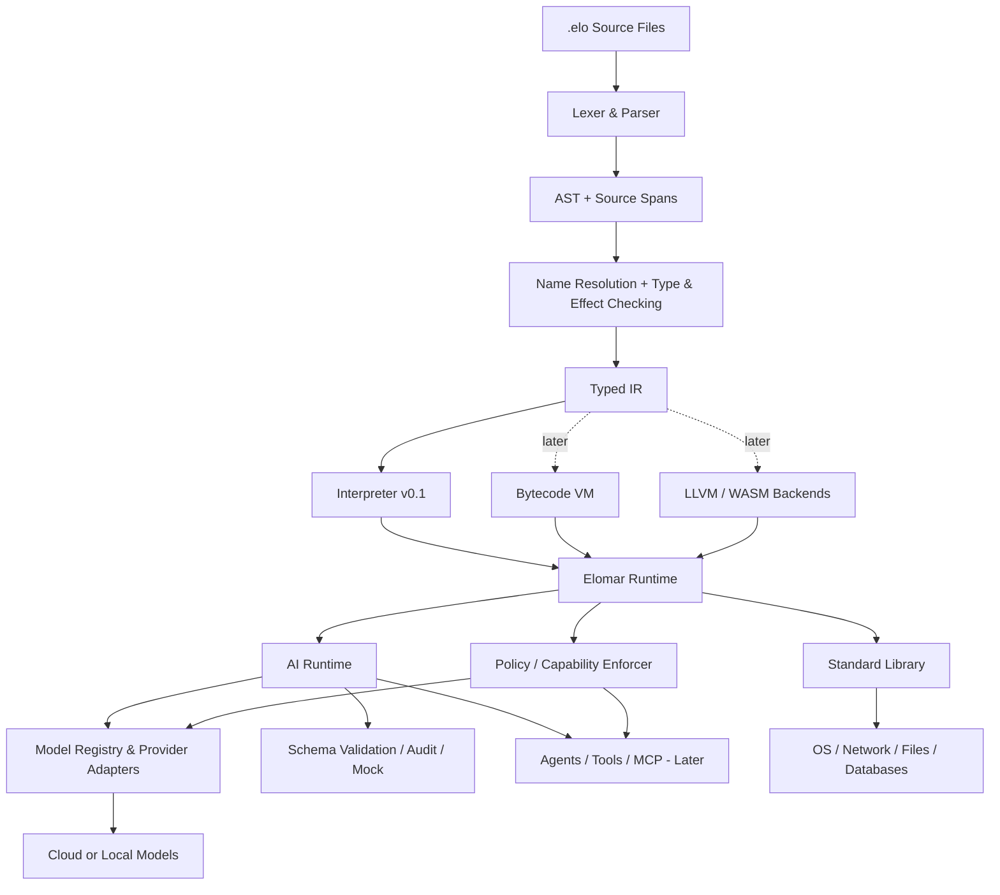

# Elomar-Lang

## المواصفة التأسيسية الشاملة للغة برمجة عامة الأغراض، أصلية التكامل مع الذكاء الاصطناعي

**Elomar-Lang — A General-Purpose, AI-Native Programming Language**

> **حالة المشروع (27 أكتوبر 2026): المرحلتان 1 و2 منفذتان** (`async`/`await` و`ai.infer<T>` مع مزود Mock دون إنترنت ومزود OpenAI حقيقي، وقائمة المضيفين المسموحة، وتأثير `net`). يوجد في المستودع مفسّر مكتوب بـ Rust ينفذ الجزء المذكور في [`docs/grammar.md`](docs/grammar.md) فقط. ما عدا ذلك من أوامر وأمثلة في هذه الوثيقة **تصميمات مستهدفة** لا يُفترض أنها تعمل قبل تنفيذها. هذه الوثيقة لا تدّعي تسجيل الاسم كعلامة تجارية أو حجزه على GitHub.
>
> **مرجعية الوثائق:** هذه الوثيقة تحمل الرؤية والمعمارية والخطة. أما **القواعد النحوية والدلالية الدقيقة** للجزء المنفذ فمرجعها الوحيد [`docs/grammar.md`](docs/grammar.md)؛ عند أي تعارض يُعتمد `grammar.md`.

## سجل التعديلات — draft.2

| التعديل | القسم |
|---|---|
| الفاصلة المنقوطة اختيارية؛ نهاية السطر تُنهي الجملة وفق قواعد محددة | 3.1، 8.1، 8.5، 9 |
| `-> Unit` اختيارية، و`main` لا تحتاج تصريح تأثيرات | 9، 16.2 |
| التأثيرات تُستنتج آليًا للدوال الخاصة، وتصريحها إلزامي للدوال العامة `pub` فقط | 16.2 |
| `/` تعطي دائمًا `Float`، و`div` للقسمة الصحيحة، وترقية `Int` إلى `Float` في الحساب المختلط | 8.4، 10.3 |
| قاعدة فك الغموض بين `<` والأنواع العامة عند الاستدعاء | 10.5 |
| السجلات بنيوية (Structural) بصيغة `{ field: value }` في موضع التعبير | 8.3، 10.4 |
| دلالة القيمة (Value Semantics) للقوائم والسجلات مع نسخ عند الكتابة | 10.7، 12.1 |
| النصوص: لا فهرسة بالأرقام، والطول بالحروف المرئية | 10.8 |
| تعدد التأثيرات للدوال العليا (Effect Polymorphism) | 16.2، RFC-0003 |
| قسم جديد: لماذا Elomar-Lang؟ والتموضع مقابل البدائل | 4.2 |
| الشمول عبر المنظومة والتكامل، لا عبر تضخيم النواة | 4.3 |
| دعم عربي من الدرجة الأولى: رسائل أخطاء ثنائية اللغة | 4.4، 20.1 |
| رفع أولوية جسر Python إلى P1 / v0.3 | 19 |
| `Option`/`Result`/`match` الأساسية انتقلت إلى v0.1 | 10.2 |
| فصل القواعد النحوية إلى `docs/grammar.md` | 9 |

## سجل التعديلات — تنفيذ المرحلة 2

| التعديل | القسم |
|---|---|
| `async fn` و`await` بمنفّذ تسلسلي كسول (الجسم يُنفذ عند أول `await`، والنتيجة تُحفظ) | 12.3، grammar §4.5 |
| `ai.infer<T>(model, instructions, input, timeout)` مع تحقق من تمثيل JSON للنوع وقت الترجمة | 13.2، grammar §4.6 |
| التحقق من مطابقة الإجابة للنوع (حقول ناقصة/زائدة/أنواع خاطئة) ← `InvalidStructuredOutput` مع مسار الحقل | 13.3 |
| `AIError` مؤقتًا سجل `{ kind, message }` حتى إضافة `enum` في v0.2 | 13.4 |
| مزود Mock بقواعد في `elomar.toml` تحاكي الإجابات والأخطاء وزمن الاستجابة دون انتظار فعلي | 14.4، grammar §4.6.1 |
| نموذج `mock` مدمج يعيد قيمة بديلة من النوع المطلوب | 21 (المثال F) |
| سياسة `max_calls_per_run` ← `BudgetExceeded` | 16.5 |
| المدد الزمنية `10s` و`500ms` نوع `Duration` | 8.3 |

## سجل التعديلات — بداية المرحلة 3

| التعديل | القسم |
|---|---|
| الأنواع المعدودة `enum` (اسمية، تعاودية، بقيم موضعية) مع شمول `match`؛ الإنشاء `Shape.Circle(1.0)` بالنقطة لا بـ `::` | 10.2، grammar §4.7 |
| `AIError` نوع معدود مدمج: `AIError.Timeout(msg)` مع `e.kind()` و`e.message()` | 13.4 |
| النوع المعدود ذو الحالات الاسمية يُرسل إلى النموذج كقيمة نصية محصورة ويُتحقق منها | 13.3 |
| `Map<K, V>` بصياغة `["a": 1]` و`[:]`، ومفاتيح `String`/`Int` | 10.2، grammar §4.8 |
| المعامل `?` على `Result` و`Option` | 10.6، grammar §4.9 |
| مزود OpenAI (Chat Completions + Structured Outputs بوضع strict) بمفتاح من متغير بيئة يُقرأ عند الاستدعاء | 14 |
| `[permissions] network_hosts` بمنع افتراضي يُفحص قبل كل اتصال، وعدم اتباع إعادة التوجيه، وإلزام https | 16.1، 16.3 |
| `ai.infer` على نموذج سحابي يُحدث `net` إضافة إلى `ai` (يُستنتج من `elomar.toml` وقت الترجمة) | 13.1، 16.2 |

| الحقل | القرار المقترح |
|---|---|
| الاسم الرسمي | **Elomar-Lang** |
| اسم اللغة في الأدوات والحزم | `elomar` |
| امتداد الملفات | `.elo` |
| أداة سطر الأوامر | `elomar` |
| ملف إعداد المشروع | `elomar.toml` |
| ملف تثبيت التبعيات | `elomar.lock` |
| لغة بناء المترجم ومحرك التشغيل | **Rust** |
| أسلوب التنفيذ الأول | مفسّر AST مستقل؛ ثم Bytecode VM؛ ثم LLVM عند الحاجة |
| نموذج البرمجة | متعدد الأساليب: إجرائي، وظيفي، كائني، غير متزامن، وAI-native |
| أنواع البيانات | أنواع ثابتة مع استنتاج الأنواع محليًا، دون تحويلات ضمنية خطِرة |
| إدارة الذاكرة | ذاكرة مُدارة في البداية، مع مواصفة أكثر نضجًا قبل الإصدار المستقر |
| الأمن | صلاحيات صريحة، ضوابط عند حدود الأدوات، وقابلية للعزل على مستوى النظام |
| المستهدف الأول | تطبيقات CLI، والأتمتة، والخدمات الخلفية، وتكامل AI |
| المستهدف اللاحق | تطبيقات الويب، وسطح المكتب، والهاتف، والحوسبة العالية الأداء |
| نوع الترخيص المقترح **عند النشر العام** | Apache-2.0 بعد مراجعة الملكية والحقوق؛ لم يُطبَّق بعد |
| المالك القانوني وحقوق الاسم | يحدده صاحب المشروع صراحة قبل النشر |

---

## محتويات الوثيقة

1. [الملخص التنفيذي وحدود المشروع](#section-01)
2. [الرؤية والرسالة وأهداف النجاح](#section-02)
3. [فلسفة التصميم والقرارات التي لا نساوم عليها](#section-03)
4. [الميزات المقارنة باللغات المعروفة](#section-04)
5. [حالات الاستخدام والمنصات المستهدفة](#section-05)
6. [الهيكل المعماري الكامل](#section-06)
7. [استراتيجية المترجم ومحركات التنفيذ](#section-07)
8. [المواصفة المعجمية (Lexical Specification)](#section-08)
9. [قواعد كتابة اللغة (Syntax)](#section-09)
10. [نظام الأنواع والبيانات](#section-10)
11. [الدوال والوحدات والمجالات والكائنات](#section-11)
12. [إدارة الذاكرة والأخطاء والتزامن](#section-12)
13. [الذكاء الاصطناعي بصفته قدرة أصلية في اللغة](#section-13)
14. [تعدد النماذج وموصلات مزودي AI](#section-14)
15. [الوكلاء والأدوات وMCP وRAG](#section-15)
16. [نموذج الأمان والخصوصية والحوكمة](#section-16)
17. [المكتبة القياسية](#section-17)
18. [قواعد البيانات والويب والواجهات](#section-18)
19. [التكامل مع اللغات الأخرى والمنصات](#section-19)
20. [أدوات المطور وإدارة الحزم والتوثيق](#section-20)
21. [أمثلة تطبيقية متدرجة](#section-21)
22. [مواصفات المشروع وهيكلة المستودع](#section-22)
23. [خطة التنفيذ ومراحل الإصدارات](#section-23)
24. [خطة الاختبارات والجودة والقياس](#section-24)
25. [المخاطر والتكلفة والافتراضات](#section-25)
26. [التراخيص والملكية والنشر على GitHub](#section-26)
27. [قالب README عام للمشروع](#section-27)
28. [معايير القبول ومهام البداية](#section-28)
29. [قرارات معمارية معلّقة وRFCs](#section-29)
30. [المصطلحات والمراجع الرسمية](#section-30)

---

<a id="section-01"></a>
# 1. الملخص التنفيذي وحدود المشروع

**Elomar-Lang** مشروع لإنشاء لغة برمجة **مستقلة وعامة الأغراض** تساعد المطور على كتابة منطق برمجي تقليدي بصورة موثوقة، وتتيح استخدام نماذج الذكاء الاصطناعي والأدوات والاسترجاع المعرفي وتنسيق الوكلاء عبر واجهات متسقة مع نظام أنواع وصلاحيات واضح.

**الهدف:** الانتقال من فكرة «أضف مكتبة LLM إلى لغة موجودة» إلى نموذج «استدعاء AI نوعٌ أصيل من العمليات الخارجية التي يفهمها المترجم، وتضبطها بيئة التشغيل، ويسهل اختبارها ومراقبتها».

**ما Elomar-Lang؟**

- لغة حقيقية بقواعد ونظام أنواع ومفسّر/مترجم خاصين بها، لا مجرد Prompt وواجهة دردشة.
- قادرة على كتابة برامج **لا تستخدم الذكاء الاصطناعي إطلاقًا**؛ فهو قدرة اختيارية وليست شرطًا لتشغيل أي برنامج.
- مصممة للتوسع نحو خدمات خلفية، وواجهات API، وتطبيقات متعددة المنصات، والبرمجة عالية الأداء.
- تملك منظومة معيارية موحّدة للمكتبات والأدوات والاختبارات والتوزيع.

**ما ليست عليه؟**

- ليست نسخة حرفية من كل لغات العالم؛ الجمع بين جميع قواعدها المتعارضة سيجعلها غير قابلة للصيانة.
- ليست طريقة سحرية لجعل LLM حتميًا أو صحيحًا دائمًا.
- ليست محركًا يترجم كل برنامج أثناء التشغيل عبر AI: التنفيذ الطبيعي يبقى محدد المعنى.
- ليست لغة مكتملة حاليًا؛ لا يُسمح بتسويق قدرات مخطط لها باعتبارها وظائف منجزة.
- لا تستلزم تدريب نموذج جديد، ولا يلزم أن تتبع شركة AI واحدة.

**مقياس النجاح الأول:** إمكانية كتابة برنامج `.elo` وتشغيله محليًا، واختباره دون شبكة، واستخدام AI عند الطلب مع التحقق من المخرجات والقيود الأمنية المعلنة.

<a id="section-02"></a>
# 2. الرؤية والرسالة وأهداف النجاح

## 2.1 الرؤية

بناء لغة موحّدة وذات أداء قابل للتحسين، تجمع مرونة التطوير السريع والانضباط النوعي وقدرات الذكاء الاصطناعي والتحكم الدقيق في موارد التطبيقات.

## 2.2 الرسالة

تقديم تجربة تطوير تتضمن لغة واضحة، ومترجمًا مستقلًا، ومكتبة قياسية، ونظام حزم، وبيئة تشغيل آمنة، وطبقة AI متعددة المزوّدين؛ بحيث يستطيع مطور واحد بدء مشروع صغير، وفريق هندسي تطويره إلى نظام مؤسسي دون إعادة كتابة كامل المنطق.

## 2.3 المستخدمون المستهدفون

1. مطورو الأنظمة الإدارية والمؤسسية والخدمات الخلفية.
2. مطورو الأتمتة والمهام والربط بين الأنظمة.
3. فرق بناء الوكلاء وتطبيقات AI وRAG.
4. مطورو التطبيقات متعددة المنصات مستقبلًا.
5. الباحثون في أنظمة البرمجة والمترجمات، بعد فتح المشروع للمساهمات.

## 2.4 أولويات المنتج

| الأولوية | متطلب | معنى النجاح |
|---|---|---|
| P0 | تنفيذ برمجة تقليدية | برنامج حسابي أو إداري يعمل من دون API خارجي |
| P0 | قواعد موثقة واختبارات | كل سلوك أساسي محدد وله اختبار توافق |
| P0 | AI نوعيّ وآمن | استدعاء AI يعيد قيمة من نوع معروف أو خطأ واضحًا |
| P0 | موصل وهمي Mock | اختبارات متكررة دون تكاليف أو تقلبات API |
| P1 | JSON وملفات وHTTP | بناء أدوات وأنظمة بسيطة مع صلاحيات |
| P1 | منظومة حزم وإصدار | توزيع برامج قابلة للتثبيت وإعادة البناء |
| P1 | IDE وLSP | إكمال وتحديد أخطاء وتجربة تطوير مناسبة |
| P2 | Backends متعددة | WASM ثم native code عند توفر الحاجة والموارد |
| P2 | تطبيقات واجهة المستخدم | حزم مضيفة أو جسور للوصول إلى GUI/Mobile |

<a id="section-03"></a>
# 3. فلسفة التصميم

1. **Deterministic by default:** العمليات العادية محددة النتائج بحسب المدخلات وحالة النظام المعلنة؛ AI غير حتمي ويظهر صراحة في الكود.
2. **Typed and explicit:** الأنواع والتأثيرات الخارجية تعلَن أو تُستنتج ضمن قواعد مضبوطة؛ لا تحويل صامت بين نص وعدد.
3. **Safe by design:** حدود صلاحيات للملفات والشبكة والأدوات، وتحقق مستقل من مخرجات AI.
4. **Provider-neutral:** يمكن تبديل مزود AI دون تغيير تصميم البرنامج بالكامل، مع إعلان اختلاف القدرات.
5. **Local-first when possible:** البرامج التقليدية وMock AI تعمل دون إنترنت؛ النموذج المحلي خيار مستقبلًا، لا ضمانًا في كل جهاز.
6. **Interoperable:** إعادة استخدام مكتبات موجودة عبر FFI وWASM والجسور بدلاً من بناء كل شيء يدويًا.
7. **Small core, rich ecosystem:** نواة نحوية ودلالية محدودة ومكتبات واسعة قابلة للتوسعة.
8. **Observable and testable:** سجلات ومقاييس واختبارات وحدات وMock/Replay للذكاء الاصطناعي.
9. **Cross-platform deliberately:** دعم المنصات يُثبت بالاختبارات وليس بإعلان تسويقي.
10. **Open evolution:** المواصفات تتغير بواسطة قرارات هندسية موثقة قبل الاستقرار.
11. **Easy by default, strict where it matters:** البرنامج البسيط يُكتب ببساطة (`fn main() { print("مرحبا") }`)، والصرامة (تصريح التأثيرات والأنواع) تُطلب عند حدود الوحدات والحزم العامة، لا في كل سطر.

## 3.1 مفاضلات متعمدة

- نفضّل **القابلية للقراءة** على السماح بعدة صيغ متضاربة للأمر نفسه.
- نختار **الأقواس `{}` للكتل، ونهاية السطر لإنهاء الجمل** (كما في Go وKotlin وSwift)؛ الفاصلة المنقوطة `;` مسموحة فاصلًا اختياريًا عند كتابة أكثر من جملة في سطر واحد. القواعد الدقيقة في 8.5.
- نبدأ بذاكرة مُدارة، ولا نفرض نظام Borrow Checker يشبه Rust على مستخدم اللغة منذ الإصدار الأول.
- نستخدم الأنواع الثابتة مع استنتاج محلي، دون جعل كل متغير `Any` افتراضيًا.
- لا نُدخل AI في عمل `if` أو `for` أو التحقق من الأرقام: هذه عمليات برمجية لا تحتاج إلى نموذج.
- لا نعد بتفوق الأداء على C++/Rust قبل وجود قياسات مستقلة قابلة للتكرار.

<a id="section-04"></a>
# 4. الميزات المقارنة باللغات المعروفة

**الاستلهام لا يعني نسخ التنفيذ الداخلي أو قواعد اللغة حرفيًا.** يوضح الجدول الخصائص التي نريد منافستها وكيف ستصل إلى Elomar-Lang.

| اللغة المرجعية | الخاصية الملهمة | كيفية التعامل معها في Elomar-Lang | الأولوية |
|---|---|---|---|
| Python | بساطة التعبير، الأتمتة، البيانات | صياغة واضحة ومكتبات بيانات؛ روابط Python لاحقًا | P0/P2 |
| C | الربط منخفض المستوى والأنظمة | FFI C مقيد بالصلاحيات واستخدام `unsafe` مخطط | P2 |
| C++ | الأداء، الأنواع العامة، تعدد الأساليب | Generics وLLVM Native Backend لاحقًا | P2 |
| Rust | سلامة الذاكرة وتوثيق التأثيرات والأخطاء | تنفيذ المترجم بلغة Rust و`Result` وواجهات آمنة | P0 |
| Java | التطبيقات المؤسسية وهيكلة الحزم | Modules وPackages وواجهات برمجة مستقرة | P1 |
| C# | تجربة الأدوات والبرمجة غير المتزامنة | LSP وasync/await ومكتبات تطبيقات | P1 |
| JavaScript | تطوير الويب والبرمجة الحدثية | HTTP Backend وWASM/JS Bridge | P1/P2 |
| TypeScript | الأنواع القوية على مستوى التطبيقات | Type Checking واستنتاج وRecord Types | P0/P1 |
| Go | بساطة نشر الخدمات والتزامن | CLI وعمليات Async منظمة وتزامن لاحق | P1/P2 |
| PHP | تطوير خوادم الويب بسرعة | HTTP Router وقوالب ومكتبات API | P1 |
| Kotlin / Swift | بيئة تطبيقات الهواتف | Host SDK Bridges / WASM فقط بعد إثباتها | P3 |
| SQL | الاستعلامات المهيكلة | معاملات وقواعد بيانات واتصال آمن ومعلمات | P1 |
| R / Julia | الحوسبة العلمية والعددية | مكتبات عددية وربط أدوات متخصصة، لا نواة كاملة مبكرًا | P3 |
| Elixir / Erlang | نماذج التزامن والاعتمادية | Structured Concurrency ومشرف مهام لاحقًا | P3 |

**الحدود الواقعية:** ليست كل «ميزة» من لغة أخرى مناسبة للنسخ؛ فجمع Borrow Checker كامل مع GC صريح وتقييم ديناميكي بلا قيود، مثلًا، يتطلب قرارات عميقة ومتعارضة. معيارنا هو أن نوفر **قدرة مفيدة ومتسقة**، لا أن نجمع الكلمات المفتاحية.

## 4.1 ميزات أساسية مترابطة

- المتغيرات، الثوابت، العمليات الحسابية والمنطقية، المقارنات، الشروط والحلقات.
- الدوال، الاستدعاء الذاتي، النطاقات، الوحدات، وإدارة الأخطاء.
- أنماط برمجة إجرائية ووظيفية وكائنية تدريجيًا.
- Generics وTraits وEnums وPattern Matching في مراحل ما بعد الأساسيات.
- وظائف غير متزامنة، Timeouts، Cancellation، ثم Parallelism.
- JSON وHTTP وDB وملفات ونصوص ووقت وتشفير في المكتبات.
- AI typed inference وTool Calling وRAG وAgents وMCP مع سياسات.
- إدارة حزم وفحص وأتمتة اختبارات وتوثيق وأدوات CI.

## 4.2 لماذا Elomar-Lang؟ التموضع مقابل البدائل

السؤال الذي سيطرحه كل مطور: **«لماذا لا أستخدم Python أو TypeScript مع مكتبة AI؟»** الجواب المختصر: لأن المكتبة لا تستطيع أن تجعل **المترجم** يفهم أن هذه الدالة تتصل بالشبكة أو تستدعي نموذجًا، ولا أن يمنع ذلك قبل التشغيل.

| البديل | ما يقدمه جيدًا | ما الذي تضيفه Elomar-Lang |
|---|---|---|
| Python + مكتبة LLM | منظومة ضخمة وسهولة | أنواع ثابتة، وتأثيرات يتحقق منها المترجم، وفشل AI منظم كـ `Result` لا كاستثناء مفاجئ |
| TypeScript + Zod | أنواع وتحقق من المخطط وقت التشغيل | المخطط يُشتق من النوع نفسه دون تكرار تعريفه، وصلاحيات الشبكة والملفات جزء من اللغة |
| BAML | لغة وصفية لدوال LLM ذات مخرجات نوعية، تولّد عملاء Python/TS | لغة عامة كاملة لا مجرد طبقة توصيف؛ المنطق والـ AI في المكان نفسه |
| Koka | نظام تأثيرات متقدم (لغة بحثية) | تأثيرات عملية مبسطة موجهة للأمان والصلاحيات، مع منظومة تطبيقات |
| Gleam | بساطة وأدوات متكاملة منذ البداية | نموذج نحتذي به في تجربة الأدوات؛ ونضيف طبقة AI والصلاحيات |
| Mojo | أداء عالٍ لأحمال AI الحسابية | لا ننافس في الحوسبة الرقمية؛ تركيزنا تطبيقات تستخدم النماذج بأمان |

**جملة التموضع:** _Elomar-Lang لغة سهلة تفهم الذكاء الاصطناعي والصلاحيات على مستوى المترجم: ما يتصل بالشبكة أو بنموذج يظهر في النوع، ويُختبر دون إنترنت، ويُرفض إن لم يُصرَّح به._

## 4.3 الشمول عبر المنظومة لا عبر تضخيم النواة

هدف المشروع أن تكون Elomar-Lang **لغة شاملة متكاملة**. اللغات الشاملة الناجحة لا تملك نواة ضخمة؛ شموليتها تأتي من:

1. **نواة صغيرة متماسكة**: قواعد قليلة تتركب بلا استثناءات. كل ميزة نحوية جديدة تحتاج RFC يثبت أن المكتبة لا تكفي.
2. **منظومة متكاملة من أول تثبيت**: `elomar run/check/test/fmt/new/add/doc` ومنسّق رسمي وLSP ومكتبة قياسية، بأداة واحدة.
3. **التكامل مع المنظومات القائمة**: جسر Python (v0.3) وWASM/JS، كي يصل المستخدم إلى آلاف المكتبات منذ السنوات الأولى بدل إعادة كتابتها.

## 4.4 دعم عربي من الدرجة الأولى

- **رسائل المترجم ثنائية اللغة:** كل Diagnostic له نص عربي وإنجليزي بالرمز نفسه (`E2001`)، ويُختار عبر `--lang ar` أو متغير البيئة `ELOMAR_LANG`. **منفذ في المرحلة 1.**
- **النصوص العربية صحيحة افتراضيًا:** طول النص بالحروف المرئية (Grapheme Clusters) لا بالبايت، وتطبيع NFC للمعرفات، ومعرفات عربية مسموحة.
- **الكلمات المفتاحية تبقى إنجليزية** لتجنب انقسام المجتمع إلى لهجتين من اللغة نفسها.
- **توثيق ودروس عربية رسمية** بموازاة الإنجليزية.

<a id="section-05"></a>
# 5. حالات الاستخدام والمنصات المستهدفة

| نوع التطبيق | مسار الدعم الواقعي | وضعه عند كتابة الوثيقة |
|---|---|---|
| أدوات سطر الأوامر والأتمتة | Runtime محلي + stdlib | هدف v0.1 |
| معالجة ملفات وتقارير | std.fs + std.json + SDKs | v0.2 |
| API وWeb Backend | HTTP Server وRouting وAuth packages | v0.3 |
| أنظمة إدارة وامتحانات | Back-end + SQL + RBAC + واجهة موجودة | v0.3 وما بعده |
| تطبيقات AI/Agents | Typed AI ثم Agent Runtime | v0.1 ثم v0.4 |
| معالجة البيانات | Collections/CSV/Parquet عبر مكتبات | v0.4 وما بعده |
| تطبيقات سطح المكتب | Native/JS UI Host Bridge | مسار بحث P2/P3 |
| تطبيقات المتصفح | WebAssembly Frontend Bridge | مسار بحث P2/P3 |
| تطبيقات Android/iOS | SDKs وFFI وجسور رسمية | مسار بحث P3 |
| الألعاب والرسوميات | Bindings لمحركات قائمة | هدف بعيد غير مضمون |
| أدوات نظامية منخفضة المستوى | Native Backend وFFI آمن | هدف بعيد غير مضمون |

**قاعدة:** لا يعني دعم HTTP أو SQLite تلقائيًا امتلاك إطار متكامل للنظم الطبية أو المالية أو الامتحانية؛ فالتوثيق والأمن والاختبارات والتوافق مع الأنظمة الفعلية مسؤوليات إضافية.

<a id="section-06"></a>
# 6. الهيكل المعماري الكامل



## 6.1 الطبقات

1. **Frontend:** Tokenizer/Lexer، وParser، وAST، وربط أسماء، ونظام الأنواع والتأثيرات.
2. **Typed IR:** تمثيل وسيط ثابت قبل التنفيذ؛ قد يكون بسيطًا جدًا في الإصدار الأول.
3. **Execution:** مفسّر مستقل أولًا، ثم Bytecode VM وBackends إضافية إذا دعت الحاجة.
4. **Standard Library:** Collections وFiles وHTTP وDB وJSON وCLI وغيرها.
5. **AI Runtime:** استدعاءات نوعية، محولات نماذج، Schema Validation، Mock وReplay وObservability.
6. **Policy Engine:** حدود الصلاحيات والموارد والموافقات، مع فصل صلاحيات البرنامج عن مخرجات النموذج.
7. **Developer Tooling:** CLI وFormatter وDiagnostics وLSP وحزم واختبارات.

## 6.2 مسار تنفيذ برنامج تقليدي

`source.elo -> Lexer -> AST -> Type Check -> Interpreter -> Result`.

## 6.3 مسار تنفيذ استدعاء AI

`Typed call -> Effect check -> Policy check -> Provider capability check -> Request -> Model -> Schema validation -> Result<T,AIError> -> Audit metadata`.

لا تُعطى مخرجات النموذج تصريحًا لتنفيذ أفعال حساسة تلقائيًا. كل فعل يحتاج إلى أداة محددة وصلاحية على مستوى المحرك والنظام المستضيف.

<a id="section-07"></a>
# 7. استراتيجية المترجم ومحركات التنفيذ

## 7.1 تسلسل الخيارات

1. **المرحلة A: AST Interpreter:** أسرع طريق لتثبيت قواعد اللغة وتجربة التطبيقات.
2. **المرحلة B: Typed IR + Bytecode VM:** تقليل تكلفة تفسير AST وإضافة مسار أداء واضح.
3. **المرحلة C: LLVM Backend:** توليد شيفرة آلة أصلية بعد استقرار الأنواع والتمثيل الوسيط.
4. **المرحلة D: WebAssembly Backend:** تشغيل محدود الإمكانات حسب قدرة المضيف، وليس بديلًا سحريًا للهواتف والواجهات.

**LLVM اختيار للمراحل المتقدمة، وليس شرطًا لتنفيذ v0.1.** يحتوي دليل LLVM الرسمي على مراحل lexer وparser وAST وIR وJIT وnative code: [LLVM Kaleidoscope](https://llvm.org/docs/tutorial/MyFirstLanguageFrontend/).

## 7.2 مبادئ تنفيذ المترجم

- Parser من نوع Recursive Descent للتعريفات والجمل، مع Pratt Parser لأسبقية التعابير.
- كل AST Node يحمل `SourceSpan` لإنتاج أخطاء مفيدة.
- `SymbolTable` وScope لكل وحدة ووظيفة وكتلة.
- Type checker صريح؛ ممنوع تنفيذ كود ذي أخطاء نوعية معروفة.
- Diagnostics ثابتة الأكواد مثل `E1001` للمُعرّف غير المعروف و`E2001` لعدم توافق الأنواع و`E3001` للصلاحية المفقودة.
- Interpreter مستقل عن AI؛ يستدعي مكتبات Runtime عبر واجهات محددة.
- امتدادات الأداء يجب أن تحافظ على **السلوك المعياري نفسه** عبر VM وNative.

<a id="section-08"></a>
# 8. المواصفة المعجمية (Lexical Specification)

**هذه القواعد مقترحة كخط أساس للمواصفة، مع تجميد مفرداتها الأساسية بعد اختبارها.**

## 8.1 الملفات والترميز

- ترميز المصدر: **UTF-8**.
- امتداد الملف: `.elo`.
- التعليقات: `// تعليق سطر واحد` و`/* تعليق متعدد الأسطر */`؛ التعليقات متعددة الأسطر غير متداخلة مبدئيًا.
- أسماء المعرفات: Unicode XID_Start/XID_Continue مع `_` وفق ملف تعريف مثبت من [Unicode UAX #31](https://unicode.org/reports/tr31/). تسمح الفكرة بأسماء عربية بعد الاختبارات.
- تُفرض صيغة NFC ثابتة للمعرفات في خط المعالجة المقترح، وتصدر تحذيرات عن أسماء متشابهة بصريًا/مختلطة النصوص.
- كلمات اللغة المحجوزة الأساسية بالإنجليزية لتقليل ازدواج الصياغة؛ يمكن كتابة تعليقات وأسماء متغيرات بالعربية.
- نهاية السطر تُنهي الجملة وفق قواعد 8.5؛ و`;` فاصل اختياري. الكتل تحددها `{}`.
- لا نعتمد المسافات البادئة لتحديد النطاق.
- لا يوجد `null` عام؛ تُستخدم `Option<T>` للغياب بصورة مقصودة.

## 8.2 كلمات محجوزة مبدئية

`let`، `var`، `fn`، `return`، `if`، `else`، `while`، `for`، `in`، `break`، `continue`، `true`، `false`، `type`، `enum`، `match`، `use`، `pub`، `async`، `await`، `trait`، `impl`، `self`، `as`، `div`.

الكلمات `trait` و`impl` و`enum` و`async` و`await` و`self` و`as` محجوزة من البداية لتجنب تعارض الأسماء، حتى لو لم تنفذ في المرحلة 1. أما `Some` و`None` و`Ok` و`Err` فليست كلمات محجوزة بل أسماء معرّفة مسبقًا في الـ Prelude.

## 8.3 الأنواع الحرفية

- أعداد صحيحة: `0` و`42` و`1_000_000` و`-7` (الإشارة السالبة عملية أحادية وليست جزءًا من token العدد).
- أعداد عشرية: `3.14` و`1.0` و`2.5e3` (نوع `Float64` افتراضيًا).
- قيم منطقية: `true` و`false`.
- نصوص: `"hello"` و`"مرحبا"` مع هروب `\n` و`\t` و`\r` و`\0` و`\"` و`\\` و`\u{0627}`.
- قوائم: `[1, 2, 3]`.
- Records: `{ name: "Lina", age: 25 }` في **موضع التعبير** فقط (بعد `=` أو `(` أو `,` أو `return`...). في موضع الجملة تبدأ `{` كتلةً دائمًا، فلا غموض. السجلات بنيوية: يطابق السجل أي نوع له الحقول نفسها بالأنواع نفسها.
- النطاقات: `0..10` (لا يشمل 10) و`1..=10` (يشمل 10)، تُستخدم مع `for`.
- الملحقات `r"raw"` والاستيفاء النصي مؤجلة حتى بعد الإصدار الأول؛ بديلها المؤقت `print("Total:", total)` الذي يفصل القيم بمسافة.

## 8.4 أسبقية العمليات (من الأعلى إلى الأدنى)

| المستوى | العمليات |
|---|---|
| 1 | الأقواس `()`، والوصول إلى الحقول `.`، والاستدعاء `()`، والفهرسة `[]` |
| 2 | أحادي `!` و`-` |
| 3 | `*` و`/` و`div` و`%` |
| 4 | `+` و`-` |
| 5 | `..` و`..=` (غير تجميعية) |
| 6 | `<`، `<=`، `>`، `>=` |
| 7 | `==`، `!=` |
| 8 | `&&` |
| 9 | `\|\|` |
| إسناد | `=` و`+=` و`-=` و`*=` و`/=` على `var` فقط؛ جملة وليست تعبيرًا ذا قيمة |

الشرط في `if` و`while` يجب أن يكون `Bool`. لا تُقبل قيمة عددية أو نصية بمعنى true/false تلقائيًا.

## 8.5 قواعد نهاية السطر

يحوّل الـ Lexer نهاية السطر إلى فاصل جمل **فقط** عندما تتحقق الشروط الثلاثة:

1. آخر رمز في السطر يمكن أن يُنهي جملة: معرّف، أو قيمة حرفية، أو `true`/`false`، أو `)` أو `]` أو `}`، أو `return` أو `break` أو `continue`.
2. لسنا داخل `()` أو `[]` مفتوحة؛ داخلها تُتجاهل الأسطر الجديدة كليًا.
3. أول رمز في السطر التالي ليس `.` ولا `else`؛ فيُسمح بسلاسل الاستدعاء وبكتابة `else` في سطر مستقل.

النتيجة العملية: السطر الذي ينتهي بعامل (`+` أو `&&` أو `,` أو `=`) يكمل في السطر التالي تلقائيًا. القوس المفتوح `{` لكتلة `if`/`while`/`fn` يجب أن يكون في سطر الرأس نفسه (كما في Go).

<a id="section-09"></a>
# 9. قواعد كتابة اللغة (Syntax)

## 9.1 نحو EBNF مبسط للنواة الأولى

> **المرجع الكامل والملزم:** [`docs/grammar.md`](docs/grammar.md) يحتوي القواعد الكاملة للتعابير والأنماط و`match` والسجلات، ودلالاتها، وجدول رموز الأخطاء. ما يلي ملخص.

```ebnf
program         = { sep } , { item , { sep } } ;
sep             = NEWLINE | ";" ;
item            = use_decl | type_decl | const_decl | function_decl ;
use_decl        = "use" , path ;
type_decl       = "type" , IDENT , "=" , type ;
const_decl      = "let" , IDENT , [ ":" , type ] , "=" , expr ;
function_decl   = [ "pub" ] , "fn" , IDENT , "(" , [ params ] , ")" ,
                  [ "->" , type ] , [ effect_set ] , block ;
params          = param , { "," , param } , [ "," ] ;
param           = IDENT , ":" , type ;
effect_set      = "!" , "{" , [ IDENT , { "," , IDENT } ] , "}" ;
block           = "{" , { sep } , { stmt , { sep } } , "}" ;
stmt            = let_stmt | assign_stmt | if_stmt | while_stmt | for_stmt
                | "return" , [ expr ] | "break" | "continue" | block | expr ;
let_stmt        = ( "let" | "var" ) , IDENT , [ ":" , type ] , "=" , expr ;
assign_stmt     = place , ( "=" | "+=" | "-=" | "*=" | "/=" ) , expr ;
if_stmt         = "if" , expr , block , [ "else" , ( block | if_stmt ) ] ;
while_stmt      = "while" , expr , block ;
for_stmt        = "for" , IDENT , "in" , expr , block ;
type            = IDENT , [ "<" , type , { "," , type } , ">" ]
                | "{" , [ field_type , { ( "," | NEWLINE ) , field_type } ] , "}" ;
```

قرار `async`/`await` والأنواع العامة المعرّفة من المستخدم و`enum` مؤجل إلى مراحله، والكلمات محجوزة.

## 9.2 قواعد النطاق والاسم

- `let` تُعرّف قيمة غير قابلة لإعادة الإسناد؛ و`var` تسمح بالإسناد.
- لا يُسمح بإعادة تعريف اسم في **النطاق نفسه**؛ استخدام الاسم داخل نطاق داخلي مع تحذير Shadowing مقبول مبدئيًا.
- يجب تعريف المتغير قبل الاستخدام.
- لا يُقبل الوصول إلى متغير محلي غير مهيأ.
- العناصر الخارجية للوحدة خاصة افتراضيًا، ويستخدم `pub` لإتاحتها.
- تنتهي الجملة بنهاية السطر (8.5) أو بـ`;` أو بـ`}` التي تغلق الكتلة.
- `-> Unit` اختيارية: الدالة بلا نوع إرجاع تُرجع `Unit`.
- `main` لا تأخذ معاملات، ولا تحتاج تصريح تأثيرات؛ تُستنتج تأثيراتها وتُقيَّد بصلاحيات المشروع (`elomar.toml`) عند تنفيذها.

## 9.3 مثال أساسي بصياغة مستقرة مستهدفة

```elomar
fn sum(a: Int, b: Int) -> Int {
    return a + b
}

fn main() {
    let total: Int = sum(10, 20)
    print(total)
}
```

الناتج المستهدف: `30`.

## 9.4 المتغيرات والتحكم

```elomar
fn main() {
    let name = "Elomar"
    var counter: Int = 0

    while counter < 3 {
        print(name)
        counter = counter + 1
    }

    if counter == 3 {
        print("Finished")
    } else {
        print("Unexpected state")
    }
}
```

## 9.5 التكرار على القوائم

```elomar
fn main() {
    let grades: List<Int> = [70, 85, 94]
    for grade in grades {
        print(grade)
    }
}
```

<a id="section-10"></a>
# 10. نظام الأنواع والبيانات

## 10.1 المبادئ

- **Static typing:** يتم رفض التعارضات المعروفة قبل التنفيذ.
- **Local inference:** يمكن كتابة `let x = 5` ليستنتج النظام `Int`.
- **No implicit coercion:** لا تتحول `"5"` إلى `5` تلقائيًا.
- **Explicit optionality:** `Option<T>` بدل null القابل للتسرب.
- **Explicit errors:** `Result<T, E>` للعمليات التي قد تفشل بصورة متوقعة.
- **Generics** و`Traits` مستهدفة، لكن لا تدخل كاملة في v0.1.

## 10.2 جدول الأنواع

| النوع | المعنى | الإصدار المستهدف |
|---|---|---|
| `Int` | عدد صحيح موقّع 64-بت (`Int64`) | v0.1 |
| `Float` | عائم IEEE-754 بدقة 64-بت (`Float64`) | v0.1 |
| `Bool` | قيمة منطقية | v0.1 |
| `String` | سلسلة Unicode مُدارة | v0.1 |
| `Unit` | غياب قيمة الإرجاع المفيدة | v0.1 |
| `List<T>` | قائمة ذات عناصر متجانسة | v0.1 |
| `Option<T>` | `Some(value)` أو `None` | v0.1 (مع `match`) |
| `Result<T,E>` | `Ok(value)` أو `Err(error)` | v0.1 (مع `match`) |
| `Range` | `a..b` و`a..=b` للتكرار | v0.1 |
| `Bytes` | بيانات ثنائية | v0.2 |
| `Map<K,V>` / `Set<T>` | خرائط ومجموعات | `Map` **منفذ**؛ `Set` في v0.2 |
| `Record` / `type X = {...}` | نوع مهيكل بنيوي ذو حقول محددة | v0.1 |
| `Enum` | نوع مغلق متعدد الحالات، بقيم اختيارية لكل حالة | **منفذ** (v0.2) |
| `Duration` / `DateTime` | زمن وفترات | v0.2 |
| `Decimal` | عدد عشري ملائم لبعض العمليات المالية | v0.3 |
| `Future<T>` | عملية غير متزامنة | v0.1 للـ AI، ثم تعميم v0.3 |
| `Sensitive<T>` | تعليمة/نوع يتتبع بيانات حساسة | v0.4 تجريبي |
| `Dynamic` | بيانات ديناميكية مضبوطة | قرار RFC لاحق |

## 10.3 دلالات عددية

- `Int` هو `Int64` موقّع في خط الأساس.
- **`/` تعطي دائمًا `Float`**، حتى بين عددين صحيحين: `7 / 2 == 3.5`. هذا يزيل أشهر فخ للمبتدئين.
- **`div` للقسمة الصحيحة** وتقطع نحو الصفر: `7 div 2 == 3`، و`%` باقي القسمة بالإشارة نفسها: `-7 % 2 == -1`. (لم نستخدم `//` لأنها رمز التعليق.)
- **الحساب المختلط:** في `+ - * /` والمقارنات، إذا كان أحد الطرفين `Float` يُرقّى `Int` إلى `Float`. هذه ترقية عددية آمنة ومحددة، لا تحويل ضمني بين نص وعدد. الإسناد إلى متغير `Int` لا يقبل `Float` إلا بـ`to_int()` صريحة.
- قسمة الصفر (بما فيها العائمة) وخروج الأعداد الصحيحة عن المدى يصدر عنهما خطأ تنفيذي محدد في جميع أوضاع البناء، لا تغيير صامت للسلوك بين Debug وRelease.
- لا تُستخدم `Float` لحسابات مالية دقيقة؛ يخصص `Decimal` لاحقًا.
- المقارنة بين floats تتطلب مراعاة NaN؛ لا نفترض مساواة جميع الحالات.

## 10.4 السجلات والأنواع المقيدة

```elomar
type Student = {
    id: Int,
    name: String,
    average: Float
}

fn describe(s: Student) -> String {
    return s.name
}

fn main() {
    let lina = { id: 1, name: "Lina", average: 91.5 }
    print(describe(lina))
}
```

السجلات **بنيوية**: `type Student = {...}` اسم مستعار لبنية، وأي سجل بالحقول والأنواع نفسها يطابقها (كما في TypeScript). هذا يتيح كتابة السجل دون تكرار اسم النوع، ويجعل اشتقاق JSON Schema لـ `ai.infer` مباشرًا.

## 10.5 الأنواع العامة والواجهات — مستقبلي

**قاعدة فك الغموض عند الاستدعاء:** في `f<T>(x)` يحاول الـ Parser قراءة `<...>` قائمةَ أنواع؛ فإن نجح وجاء بعدها مباشرة `(` فهي معاملات نوع لاستدعاء، وإلا فهي عملية مقارنة `<`. هذه القاعدة المعتمدة في C# وTypeScript وKotlin، وتحفظ الصيغة المألوفة `ai.infer<Ticket>(...)` دون رموز مثل `::<>`. التعبير `a < b > (c)` يُفسر استدعاءً، ولا خسارة لأن مقارنة `Bool` بعدد خطأ نوعي على كل حال.

```elomar
// Illustrative v0.3; not part of v0.1 guaranteed grammar
fn first<T>(values: List<T>) -> Option<T> {
    if values.length == 0 {
        return None
    }
    return Some(values[0])
}
```

## 10.6 الفشل والنتائج

- الاستثناءات غير المقصودة، مثل فساد حالة المحرك، تختلف عن الأخطاء المتوقعة مثل فشل الشبكة أو رفض السياسة.
- ينبغي أن تعيد العمليات الخارجية `Result<T,E>` بدل إسقاط الأخطاء أو إرجاع نص غير محدد.
- **منفذ:** المعامل `?` ينشر `Err`/`None` إلى الدالة المستدعية (انظر `docs/grammar.md` §4.9).

## 10.7 دلالة القيمة (Value Semantics)

القوائم والسجلات والنصوص **قيم** لا مراجع مشتركة:

```elomar
fn main() {
    var a = [1, 2, 3]
    var b = a
    b.push(4)
    print(a.length, b.length)   // 3 4
}
```

- الإسناد والتمرير إلى دالة ينسخان القيمة منطقيًا؛ التنفيذ يستخدم **نسخًا عند الكتابة** (Copy-on-Write) فلا يكلف النسخ شيئًا ما لم يحدث تعديل.
- التعديل (`push` و`xs[i] = v` و`rec.field = v`) مسموح على متغير `var` فقط، ويؤثر في ذلك المتغير وحده.
- النتيجة: لا Aliasing مفاجئ، ولا يمكن تكوين دورات مرجعية، فلا تسريبات ذاكرة من الدورات (انظر 12.1).

## 10.8 النصوص وUnicode

- `s.length` عدد **الحروف المرئية** (Grapheme Clusters) لا البايتات: `"مرحبا".length == 5`.
- لا فهرسة للنص بالأرقام (`s[0]` خطأ نوعي) لأن موضع البايت لا يطابق موضع الحرف في العربية؛ تُستخدم `s.chars()` التي تعيد `List<String>`.
- المقارنة بين النصوص بحسب نقاط Unicode، والتطبيع NFC للمعرفات في الشيفرة المصدرية.

<a id="section-11"></a>
# 11. الدوال والوحدات والكائنات

## 11.1 الدوال

```elomar
fn is_adult(age: Int) -> Bool {
    return age >= 18
}
```

يجب أن يعرف المترجم أنواع المعلمات والإرجاع للدوال العامة؛ يمكن استنتاج المتغيرات المحلية. لا تتغير الأسماء العامة للمعلمات أو دلالاتها بصمت بعد استقرار الإصدار.

## 11.2 الوحدات Modules

```elomar
// src/main.elo
use std.io
use app.students

fn main() {
    print(students.count())
}
```

`use` لاستيراد الوحدات. قد يرتبط مسار `app.students` بملف `src/students.elo` وفق آلية مشروع محددة في RFC الموديولات؛ لا يُفترض توفرها قبل تنفيذها.

## 11.3 أساليب البرمجة المستهدفة

| الأسلوب | المفهوم | وقت إضافته |
|---|---|---|
| إجرائي | دوال وتحكم | v0.1 |
| وظيفي | دوال كقيم وClosures وMap/Filter | v0.3 |
| كائني | Records وMethods وTraits وComposition | v0.3 |
| غير متزامن | `async/await` ثم Task Groups | AI مبدئي v0.1؛ عام v0.3 |
| قائم على الأحداث | Event handlers وStreams | v0.4 |
| Data-oriented | أدوات Collections ونقل/ربط بيانات | v0.3+ |
| AI-native | Typed inference / tools / agents | تدريجيًا |

لا نلتزم بنسخ الوراثة المتعددة التقليدية؛ يفضَّل Composition وTraits لتجنب تعارضاتها.

<a id="section-12"></a>
# 12. إدارة الذاكرة والأخطاء والتزامن

## 12.1 إدارة الذاكرة

**موقف التصميم:** تُدار ذاكرة مستخدم Elomar-Lang آليًا، ولا يكتب المبرمج `malloc/free` في كود التطبيق العادي.

- v0.1: **دلالة القيمة** (10.7) منفذة بعدّ المراجع (`Rc`) مع النسخ عند الكتابة. لأن القيم لا تشير إلى بعضها بمراجع قابلة للتعديل، **لا يمكن تكوين دورات مرجعية أصلًا**، فيكفي عدّ المراجع دون Garbage Collector.
- قبل إصدار مستقر: يُعاد تقييم الحاجة إلى GC فقط إذا أُدخلت ميزات تسمح بالدورات (مثل Closures تلتقط متغيرات قابلة للتعديل أو كائنات مرجعية مشتركة)، مع اختبار الذاكرة والأداء.
- Native FFI: عزل المؤشرات الأصلية خلف واجهات `unsafe` وصلاحيات، وعدم إسقاطها ضمن نوع `String` أو `List` المعتاد.
- عدم الادعاء بأن كتابة المترجم بلغة Rust وحدها تمنع جميع أخطاء برامج اللغة المضيفة أو ثغرات المكتبات الخارجية.

## 12.2 نموذج الأخطاء

| الصنف | مثال | السلوك المخطط |
|---|---|---|
| Compile Error | اسم غير معرف | رفض البرنامج مع رقم سطر وموضع |
| Type Error | جمع نص وعدد | رفض البرنامج قبل التشغيل |
| Runtime Error | قسمة صفر | خطأ تنفيذي موثق ورسالة قابلة للتشخيص |
| IO Error | ملف غير موجود | `Result` بخطأ ملف |
| AI Error | مهلة أو رفض سياسة | `Result<T, AIError>` |
| Security Error | محاولة أداة غير مصرح بها | رفض قبل تنفيذ الأثر الخارجي |

## 12.3 التزامن

- v0.1: حد أدنى من `async/await` يسمح باستدعاء AI وإرجاع `Future` مع Executor بسيط؛ **لا نعد بعمليات متوازية أو Actors**.
- v0.3: نظام Tasks وTimeout وCancellation وStructured Concurrency؛ تنتظر المهام الفرعية أو تُلغى وفق نطاق واضح.
- v0.4+: Streams وChannels وربما Actors بعد تقييم الكلفة والهندسة.
- صلاحيات الأدوات تنتقل بصورة مضبوطة إلى المهام ولا تتوسع تلقائيًا.
- المهلة تُحدد لمهام الشبكة، لكن إلزامها يتطلب دعم الموصل والمضيف.

<a id="section-13"></a>
# 13. الذكاء الاصطناعي بوصفه قدرة أصلية

## 13.1 الفكرة الأساسية

بدل إضافة مكتبة غير منضبطة تُرجع نصوصًا حرة فقط، تعرّف Elomar-Lang **عمليات AI نوعية وذات تأثيرات محددة**، لها مهلات وأخطاء وقيود تكلفة وتصريح نقل البيانات. المترجم يتحقق من نوع القيمة المعلَن، ومحرك التشغيل يرسل الطلب ويختبر النتيجة.

**تعريف مفاهيمي:**

```text
ai.infer<T>(model, instructions, input, timeout, ...) -> Future<Result<T, AIError>>
```

- `T`: نوع النتيجة المطلوبة، مثل سجل `Ticket`.
- `model`: الاسم المنطقي لنموذج مُسجل في إعداد المشروع، لا اسم تجاري مفروض في الكود.
- `instructions`: التوجيهات الموثقة التي يُسمح بتقديمها للنموذج.
- `input`: بيانات الطلب، وتُعامل بوصفها بيانات قد تكون غير موثوقة.
- `AIError`: فئات خطأ للاتصال والمهلة ورفض السياسة والمخرجات المخالفة للنوع وغيرها.
- يحتاج الاستدعاء إلى التأثيرين `ai` و`net` عندما يكون النموذج سحابيًا. يمكن لموصل محلي إثبات أنه لا يحتاج `net` بشرط أن يعلن ذلك بصدق ويقبله نظام السياسة.

## 13.2 مثال AI منظَّم (Target v0.1/v0.2)

```elomar
use std.ai

type Ticket = {
    category: String,
    priority: String,
    summary: String
}

async fn classify_ticket(message: String)
    -> Result<Ticket, AIError> !{ai, net} {
    return await ai.infer<Ticket>(
        model: "support.classifier",
        instructions: "Classify the support request into category, priority and summary.",
        input: message,
        timeout: 10s
    )
}
```

`10s` صيغة زمن مستهدفة؛ حتى تثبيتها في Lexer يمكن استخدام `Duration.seconds(10)`. مثال الدالة **مواصفة تصميمية**، وليس تنفيذًا مكتملًا أو تعهدًا بأن كل مزود يدعم `Ticket` بنحو أصيل.

## 13.3 كيف يحول المحرك النوع إلى طلب للنموذج؟

1. يحدد `TypeChecker` البنية المتوقعة `Ticket`.
2. يولد Runtime تمثيلًا مقيدًا متوافقًا مع **الجزء المدعوم** من JSON Schema أو يستخدم موصلًا مخصصًا.
3. يفحص قدرات النموذج (Structured Output/Tool Calling/Streaming...).
4. إذا لم تكن البنية مدعومة: يرفض الطلب بخطأ قدرة غير متوفرة، أو يستخدم مسارًا بديلًا **مُعلنًا** يقبل به التطبيق.
5. يرسل الطلب طبقًا لصلاحيات الشبكة والخصوصية.
6. يقرأ الاستجابة، ويرفض JSON غير الصالح أو غير المطابق للنوع أو المخرجات الناقصة.
7. يرجع `Ok(Ticket)` أو `Err(AIError)`، مع بيانات تشخيص مناسبة بلا تسريب أسرار.

**مهم:** صحة JSON ومطابقته لـ Schema ليست دليلًا على الصحة الواقعية أو المهنية للمعلومة. يجب فصل `structure_valid` عن `fact_verified` وعدم مساواتهما.

المراجع: [Structured Outputs (OpenAI)](https://platform.openai.com/docs/guides/structured-outputs)، [JSON Schema](https://json-schema.org/).

## 13.4 أصناف أخطاء AI المقترحة

```text
AIError.Authentication(message)
AIError.ProviderUnavailable(message)
AIError.RateLimited(message)
AIError.Timeout(message)
AIError.Network(message)
AIError.UnsupportedCapability(message)
AIError.InvalidStructuredOutput(message)
AIError.PolicyDenied(message)
AIError.BudgetExceeded(message)
AIError.ContextLimitExceeded(message)
AIError.Cancelled(message)
```

**منفذ** نوعًا معدودًا مدمجًا؛ كل حالة تحمل نص الرسالة، و`e.kind()` تُرجع اسم الحالة و`e.message()` الرسالة.

يجب ألا يُحوَّل كل خطأ إلى «حاول مرة أخرى» دون تمييز؛ إعادة المحاولة قد تضاعف التكلفة أو تكرر إجراءً مؤثرًا.

## 13.5 وظائف AI المخطط لها

| الوظيفة | دلالة API المستهدفة | المرحلة |
|---|---|---|
| Structured Inference | `ai.infer<T>()` | v0.1 |
| Text Generation | `ai.generate()` | v0.2 |
| Streaming | `ai.stream()` | v0.3 |
| Embeddings | `ai.embed()` | v0.3 |
| Classification | قالب مبني على `infer<T>` | v0.2 |
| Model Selection | `ai.registry` | v0.3 |
| Tool Calling | `ai.tools` | v0.4 |
| Agents | `agent` أو مكتبة `std.agent` | v0.4 |
| Multimodal | صور/صوت/ملفات حسب قدرات الموصل | v0.5+ |
| Local Models | موصلات محلية مناسبة لكل نوع نموذج | v0.4+ |
| Evaluation | `ai.eval` ومجموعات اختبارات | v0.3+ |
| Provenance | سجل المصدر والإصدار والتتبع | v0.4+ |

## 13.6 AI أثناء كتابة الكود مقابل AI أثناء تنفيذه

يُفصل بدقة بين:

- **AI Development Assistant:** مساعد خارجي داخل المحرر لكتابة الكود أو مراجعته؛ ليس جزءًا من مواصفة تنفيذ لغة Elomar-Lang.
- **AI Runtime API:** قدرة اللغة الأصلية وقت تشغيل التطبيق؛ تخضع للأنواع والتأثيرات والمهلات والسياسات.
- **AI Compiler Optimization:** استعمال نماذج للمساعدة في اقتراح تحسينات مستقبلية؛ لا يجعل نتائج بناء البرامج غير قابلة للتكرار دون قبول صريح واختبارات.

<a id="section-14"></a>
# 14. تعدد النماذج والموصلات (Provider-Neutral AI)

## 14.1 بنية الموصل

```text
Elomar Program
    -> ai.infer<T>()
    -> Capability/Privacy/Budget checks
    -> Provider Interface
        -> Cloud Provider Adapter A
        -> Cloud Provider Adapter B
        -> Cloud Provider Adapter C
        -> Local Model Adapter
    -> Response Validation + Typed Result
```

لا تُبرمج أسماء موديلات تجارية داخل Grammar. تُثبت الأسماء الفعلية في إعداد المشروع، ويتولى الموصل ترجمة الطلبات مع الحفاظ على المعاني القابلة للمقارنة قدر الإمكان.

## 14.2 واجهة الموصل (Rust-side conceptual interface)

```rust
// Architectural pseudocode; not a compiled API contract.
trait ModelProvider {
    fn capabilities(&self) -> ProviderCapabilities;
    async fn infer(&self, request: InferenceRequest)
        -> Result<InferenceResponse, ProviderError>;
}
```

**القدرات التي يفحصها الموصل:** نوع المدخلات (text/image/audio)، مخرجات JSON Schema، استدعاء أدوات، Streaming، سياق المدخلات، حد المخرجات، المهلات، نمط الخصوصية، وتوفر النموذج/الإصدار.

## 14.3 قواعد التوجيه بين النماذج

- `default_model` اسم منطقي في الإعدادات.
- `fallback_models` **اختيار صريح**، لا تحويل خفي لمزود آخر قد يغير قواعد الخصوصية.
- يمكن اختيار نموذج محلي للبيانات الحساسة إذا دعمه الجهاز والموصل.
- يجب حفظ تعريف النموذج المختار وإصدار الموصل في سجلات التتبع، دون افتراض أن الخدمة الخارجية تُثبّت النموذج دائمًا.
- عند اختلاف دعم JSON Schema/Tools يرفض المحرك الطلب أو يسلك خيار توافق معلنًا لا يُضلل البرنامج.
- المراجعة الدورية لواجهات المزود مطلوبة لأن الـ API والأسعار والإمكانات تتغير.

## 14.4 مثال إعداد `elomar.toml` (تصميم)

```toml
[package]
name = "ticket-system"
version = "0.1.0"
edition = "2026-preview"
entry = "src/main.elo"

[ai.models.support_classifier]
provider = "example_cloud"
model = "REPLACE_WITH_SUPPORTED_MODEL_ID"
api_key_env = "EXAMPLE_AI_API_KEY"
require_structured_output = true

[ai.policy]
max_calls_per_run = 20
estimated_budget_usd = 0.50
log_prompt_content = false
allow_fallback_to_other_provider = false

[permissions]
filesystem_read = ["./data"]
filesystem_write = ["./output"]
network_hosts = ["api.example-ai-provider.com"]
subprocess = false
ffi_native = false
```

اسم `example_cloud` واسم المضيف في هذا المقتطف **أمثلة توضيحية فقط**، وليسا مزودًا جاهزًا. ينبغي تخزين مفاتيح API في متغيرات بيئة أو مدير أسرار، وليس في Git أو ملفات إعداد منشورة.

<a id="section-15"></a>
# 15. الوكلاء والأدوات وMCP وRAG

## 15.1 تعريف الوكيل

Agent هو عملية منظمة تتكرر فيها خطوات: قرار مساعد / اختيار أداة / التحقق من الصلاحيات / تنفيذ الأداة / مراجعة النتيجة / التوقف عند حد واضح. لا يُسمح له بإنشاء صلاحيات من تلقاء نفسه.

**مثال واجهة مستقبلية (غير منفذة في v0.1):**

```elomar
// Target v0.4+ — illustrative syntax
agent SupportAssistant {
    model: "support.classifier"
    tools: [search_manuals, create_ticket]
    max_steps: 6
    timeout: 60s
    require_approval: [create_ticket]
}
```

تصميم Syntax الوكلاء نفسه **لم يُحسم**؛ قد يكون من الأفضل تنفيذها أولًا كمكتبة `std.agent` بدل كلمات محجوزة جديدة، لتفادي تضخيم Grammar.

## 15.2 قواعد أدوات Agent

1. كل أداة لها اسم ونطاق صلاحية وSchema واضح للمدخلات والمخرجات.
2. التحقق من الأذونات يحدث **عند نقطة تنفيذ الأداة** وليس اعتمادًا على نص Prompt.
3. عمليات الكتابة والحذف والتحويلات المالية وإرسال الرسائل تتطلب موافقة متناسبة مع خطورتها.
4. لا يُسمح للنموذج باستدعاء shell اعتباطيًا بصلاحيات المستخدم الكاملة.
5. تدعم الأدوات `idempotency key` عند الإجراءات القابلة للتكرار لتجنب آثار retries.
6. يحد المحرك من العدد الأقصى للخطوات والزمن والرموز والتكلفة.
7. تُسجل البيانات الوصفية اللازمة للتدقيق، مع إخفاء المحتوى الحساس وفق السياسة.

## 15.3 MCP

يدعم Elomar-Lang مستقبلًا الاتصال بمزوّدي الأدوات من خلال **Model Context Protocol**؛ تستخدم مكوّنات `MCP Client Adapter` اكتشاف الأدوات واستدعاءها بمخططات مدخلات مضبوطة وفق النسخة المعتمدة من البروتوكول.

**مرجع النسخة عند إعداد الوثيقة:** مواصفة MCP بتاريخ **2026-07-28** تتضمن أدوات `tools/list` و`tools/call` وقواعد ثقة وسلامة؛ يُعاد التحقق من النسخة قبل تنفيذ الموصل: [MCP Tools Specification](https://modelcontextprotocol.io/specification/2026-07-28/server/tools).

## 15.4 RAG — الاسترجاع المعزز بالتوليد

المسار المقترح:

`Documents -> Text Extraction -> Chunking -> Embeddings -> Search Index -> Authorized Retrieval -> Model Context -> Answer + Sources`.

- فصل صلاحيات البحث في الوثائق عن صلاحيات النموذج.
- الاحتفاظ بمعرف المصدر والصفحة/المقطع والتاريخ ضمن سياق الاسترجاع.
- اشتراط إظهار المصادر للادعاءات المؤسسية الحساسة عند بناء التطبيق.
- تجنب الاعتماد على اقتباس مولّد لا يمكن ربطه بمصدر حقيقي.
- منع تمرير مستندات المستخدم أو سجلاته إلى مزود خارجي دون سياسة صريحة.
- فهرسة المستندات ومعالجة OCR/Vector DB مهام مكتبات متخصصة، وليست بالضرورة كلمات في Grammar.

<a id="section-16"></a>
# 16. نموذج الأمان والخصوصية والحوكمة

**هذا القسم إلزامي هندسيًا للنسخ التي تستخدم AI أو تتعامل مع أنظمة فعلية.**

## 16.1 قائمة المخاطر

| الخطر | مثال | التخفيف الأساسي |
|---|---|---|
| Prompt Injection | مستند يُصدر أمرًا للنموذج لتجاوز السياسة | اعتباره بيانات غير موثوقة؛ فرض السياسة خارج النموذج |
| Data Exfiltration | إرسال ملف سري إلى API غير مسموح | صلاحيات ملفات وشبكة وإخراج بيانات مستقلة |
| Unsafe Tool Execution | النموذج يطلب حذف ملفات | موافقة محددة والتحقق من المدخلات قبل الأداة |
| Hallucinations | تلخيص يعطي معلومة خاطئة | تحقق بالمصادر وتقييمات بشرية/آلية مستقلة |
| Credential Leakage | تسجيل مفتاح API في Log | Redaction ومدير أسرار ومنع Push |
| SSRF / Network Abuse | الوصول إلى عنوان داخلي عبر URL | Egress allowlist وفحص إعادة التوجيه وDNS على مستوى التنفيذ |
| Package Supply Chain | مكتبة خبيثة | تدقيق حزم، Lockfile، Checksum، توقيع/Provenance لاحقًا |
| Resource Exhaustion | حلقات/طلبات AI دون حد | مهلات وحدود اتصالات وذاكرة وخطوات |
| Malicious Native FFI | مكوّن أصلي يقرأ النظام | FFI غير موثوق خارج Sandbox أو محظور |
| Incorrect Authorization | RAG يقرأ وثيقة غير مصرّح بها | تحقق هوية ونطاق وصول قبل الاسترجاع |

## 16.2 نموذج التأثيرات (Effect System)

بجانب نوع الإرجاع، يُسمح للدالة بالتصريح عن قدرات خارجية:

```elomar
fn calculate(a: Int, b: Int) -> Int {
    return a + b
}

fn write_audit(text: String) !{io, fs} {
    // Target v0.2: write to a permitted file.
}

async fn ask_model(text: String)
    -> Result<String, AIError> !{ai, net} {
    // Target v0.1+: invoke configured model.
}
```

- `!{io}` للطباعة/الطرفية و`!{fs}` للملفات و`!{net}` للشبكة و`!{ai}` لاستدعاء النموذج؛ وأثر `db` مخصص لعمليات قواعد البيانات.
- **الاستنتاج للدوال الخاصة:** الدالة غير `pub` لا تحتاج تصريحًا؛ يحسب المترجم تأثيراتها من جسمها ومن الدوال التي تستدعيها (بما فيها الاستدعاء الذاتي والمتبادل). هذا يحفظ سهولة الكتابة.
- **التصريح الإلزامي للدوال العامة:** الدالة `pub` حدّ بين وحدات أو حزم، فيجب أن تعلن تأثيراتها كاملة (الخطأ `E3002`)، كي لا يُفاجأ مستخدم الحزمة باتصال شبكي مخفي.
- **التصريح يُلزم:** إذا صرّحت أي دالة بتأثيرات فيجب أن تحتوي كل ما تفعله فعلًا (الخطأ `E3001`).
- **`main` والثوابت:** `main` تُستنتج تأثيراتها وتُقيَّد بصلاحيات `elomar.toml`؛ وقيم `let` على مستوى الملف يجب أن تكون خالية من التأثيرات (`E3004`).
- **تعدد التأثيرات للدوال العليا (v0.3، RFC-0003):** عند إضافة الدوال كقيم، يحمل نوع الدالة تأثيراتها `fn(Int) -> Int !{io}`، والدالة العليا مثل `map` تنقل تأثيرات الدالة المُمرَّرة إليها (Effect Polymorphism) بدل أن تتطلب كل التأثيرات أو تمنعها.
- تصريح `!{net}` **لا يمنح** إذن الاتصال بأي عنوان؛ السياسة تحدد المضيفين والقيود بصورة مستقلة.
- الآثار نظام مراجعة وتحليل ساكن؛ لا يُعد بديلًا لSandbox مفروض من نظام التشغيل أو منصة التشغيل.

## 16.3 سياسة منع افتراضية (Default Deny)

- العملية التقليدية الحسابية متاحة دون صلاحيات إضافية.
- الملفات والشبكات والعمليات الفرعية والـ FFI والأدوات الحساسة تُمنح تصريحًا صريحًا.
- تطبيقات الأنظمة المؤسسية ينبغي أن تفرض صلاحيات فعلية على مستوى عملية OS/Container/WASM Host؛ لا تكفي قائمة TOML إذا كان الكود قادراً على تجاوزها عبر Native FFI.
- حتى عند وجود موافقة بشرية، يتحقق Runtime من **الفعل الدقيق والهدف والمعلمات** قبل التنفيذ.
- تدقيق القرارات الأمنية مع منع تخزين الأسرار والبيانات الحساسة دون ضرورة.

مرجع تصميم التهديدات: [OWASP — LLM Prompt Injection Prevention](https://cheatsheetseries.owasp.org/cheatsheets/LLM_Prompt_Injection_Prevention_Cheat_Sheet.html).

## 16.4 أنواع البيانات الحساسة (لاحقًا)

يوضع RFC لإتاحة `Sensitive<T>` ومصدر البيانات ووسوم نقلها، بحيث يمنع المحرك تحويل أو إرسال نوع حساس إلى مزود خارجي دون تصريح صريح. **هذه ميزة بحثية غير مكتملة**، ولا يجوز اعتبار مجرد وسم للبيانات وسيلة حماية كافية.

## 16.5 سياسة AI والتكلفة

- `max_calls_per_run` و`max_steps` و`timeout` و`max_output_tokens` عند الإمكان.
- حساب تكاليف تقديرية قبل الطلب وتسجيل الاستهلاك الفعلي بعد استجابة المزود.
- فرض حدود إنفاق قاطعة يحتاج إلى دعم من المزود أو بوابة فوترة/حصص مستقلة؛ تقدير تكلفة الرموز وحده لا يضمن عدم تجاوز مبلغ نهائي.
- منع المحاولة التلقائية عند أخطاء غير قابلة للتكرار الآمن.
- عدم استخدام prompts أو responses الحساسة في Logs افتراضيًا.

<a id="section-17"></a>
# 17. المكتبة القياسية (Standard Library)

**القاعدة:** المكتبة تتسع تدريجيًا؛ عدم وجود الحزمة في إصدار مبكر لا يمنع الوصول إلى القدرة عبر تكاملات معروفة في مراحل لاحقة.

| المساحة | وحدة مقترحة | محتويات متوقعة | مستهدف |
|---|---|---|---|
| Core | `std.core` | Values, Option, Result, basic utilities | v0.1/v0.2 |
| Console | `std.io` | Print, basic input, errors | v0.1 |
| Math | `std.math` | Arithmetic, statistics helpers | v0.1/v0.2 |
| Collections | `std.collections` | List, Map, Set, iterators | v0.1/v0.2 |
| Text | `std.text` | Unicode, normalize, split, regex adapter | v0.2 |
| JSON | `std.json` | Encode, decode, schema | v0.2 |
| Files | `std.fs` | Read/write/list with policies | v0.2 |
| Time | `std.time` | Duration, DateTime, timers | v0.2 |
| HTTP | `std.http` | Client/server, routing, middleware | v0.3 |
| Network | `std.net` | Network primitives, TLS wrapper | v0.3 |
| Database | `std.db` | Query, transactions, pooled connections | v0.3 |
| Crypto | `std.crypto` | Maintained vetted algorithms, hashes, TLS integration | v0.3 |
| Logging | `std.log` | Structured logs, tracing | v0.2 |
| CLI | `std.cli` | Args, env, process exit | v0.2 |
| Async | `std.async` | Tasks, cancel, timers, channels | v0.3 |
| AI | `std.ai` | infer, generate, structured output | v0.1/v0.2 |
| AI Tools | `std.agent` | Agent runtime, tool permission, steps | v0.4 |
| Data | `std.data` | CSV, table interfaces, external analytics | v0.4 |
| Testing | `std.test` | Assert, mock, coverage hooks | v0.1/v0.2 |
| Security | `std.security` | Secret values, policy interfaces | v0.2/v0.4 |
| UI | `std.ui` | Host-specific desktop/mobile/browser bridge | P3 research |

**لا تكتب خوارزميات التشفير من الصفر**؛ استخدم مكتبات مدققة ومعيارية خلف واجهات مستقرة، وحدّثها باستمرار.

<a id="section-18"></a>
# 18. قواعد البيانات والويب وواجهات المستخدم

## 18.1 قواعد البيانات

أولوية الدعم المقترح: **SQLite** للتطبيقات المحلية، ثم **PostgreSQL** للتطبيقات المؤسسية، ثم قواعد أخرى عبر موصلات.

القواعد الأمنية والوظيفية:

- معلمات للاستعلامات بدل تركيب SQL من نص المستخدم.
- Transactions واضحة مع Commit/Rollback.
- Pooling للخوادم التي تحتاج اتصالات متزامنة.
- Migrations وإدارة مخطط البيانات عبر أدوات حزم.
- فحص صلاحيات القراءة والكتابة في التطبيق وقاعدة البيانات، وليس استدعاءات AI.

**واجهة مستقبلية توضيحية:**

```elomar
// Target v0.3; illustrative library API
use std.db

async fn get_student(id: Int)
    -> Result<Student, DbError> !{db} {
    let conn = await db.connect("main")
    return await conn.query_one<Student>(
        "SELECT id, name, average FROM students WHERE id = ?",
        [id]
    )
}
```

عند إدخال مصادر بيانات فعلية ينبغي أن تبقى بيانات الاتصال في مدير أسرار أو إعدادات غير منشورة. النوع `Student` مُعرف في وحدة التطبيق وليس جزءًا من المكتبة القياسية.

## 18.2 الويب والخدمات الخلفية

- HTTP Client/Server مع TLS عبر مضيف موثوق.
- Router وHandlers وMiddleware.
- JSON Serialization وValidation.
- Session/Authentication/Authorization حزم مستقلة، لا يُفترض أنها متاحة لمجرد وجود HTTP Server.
- Rate Limits وCSRF وCORS وSecurity Headers حسب نوع التطبيق.
- Streaming وWebSocket عبر إضافة لاحقة.
- نشر عبر خدمة مضيفة أو Container بحسب بيئة التنفيذ.

**مثال مقصود لمرحلة لاحقة:**

```elomar
// Target v0.3 — illustrative API subject to RFC
use std.http

fn health() -> HttpResponse {
    return http.json({ status: "ok" })
}

fn main() {
    let app = http.app()
    app.get("/health", health)
    app.listen("127.0.0.1:8080")
}
```

لا نعتمد هذا API قبل تصميم ملكية `app` ودورة حياة السيرفر وإدارة التزامن والأخطاء؛ وظيفته بيان تجربة المستخدم المستهدفة.

## 18.3 واجهات سطح المكتب والهاتف والمتصفح

- **سطح المكتب:** بداية عملية هي استخدام واجهة موجودة (مثل Web UI مع Host Desktop) وربطها بخدمة Elomar-Lang؛ لا ندّعي واجهة Native UI متكاملة في النسخة الأولى.
- **المتصفح:** WASM Backend مع JS bindings عند جاهزية compiler/runtime والمتصفح المضيف.
- **الهاتف:** Android/iOS يتطلبان سياسات البناء والربط والتوزيع وواجهات نظام خاصة؛ نقيّم جدوى FFI/Host SDK عند وصول المحرك لنضج مناسب.
- **تطبيقات تفاعلية عالية الأداء:** تحتاج إدخال rendering/event loop وbindings مستهدفة، وليست وظيفة تُستنتج تلقائيًا من اللغة.

<a id="section-19"></a>
# 19. التكامل مع اللغات والمنصات الأخرى

| البيئة | أسلوب التكامل المقترح | ملاحظة |
|---|---|---|
| Rust | Host libraries داخل Runtime والـ compiler | الخيار المبكر والمفضل داخليًا |
| C | C ABI / FFI | يتطلب أمن ذاكرة وملكية وصلاحيات واضحة |
| C++ | C-compatible ABI bridge أو واجهات مخصصة | لا يُفترض توافق C++ ABI عبر مترجمات مختلفة |
| Python | **أولوية P1 / v0.3:** جسر مضمّن لاستدعاء مكتبات Python بأنواع مُعلنة، مع تأثير `py` وصلاحيات؛ ثم subprocess/gRPC للعزل | أسرع طريق إلى منظومة مكتبات واسعة (بيانات، AI، ويب)؛ الجسر لا يجعل كود Python آمنًا تلقائيًا |
| JavaScript | Wasm + JS bridge أو HTTP | هدف للويب بعد بناء backend مناسب |
| Java / JVM | gRPC/HTTP أو JNI bridge لاحقًا | تكلفة صيانة مرتفعة مقارنة بالخدمات |
| C# / .NET | C ABI أو خدمات API | يعتمد على ABI وإدارة الذاكرة |
| SQL | موصلات وخيارات Mapping للأنواع | ليس لغة مضمنة جزئيًا بلا قواعد حماية |
| Cuda / GPU | Bindings لمكتبات GPU | مشروع منفصل بعد نضج Native Runtime |

هدف التكامل هو **إعادة استخدام منظومات قائمة**، لا نسخ مترجم Python أو JVM أو محرك JavaScript داخل النواة.

<a id="section-20"></a>
# 20. أدوات المطور وإدارة الحزم والتوثيق

## 20.1 أوامر CLI المقترحة

| الأمر | وظيفته | الإصدار المستهدف |
|---|---|---|
| `elomar --version` | إصدار الأداة والمحرك | v0.1 |
| `elomar run src/main.elo` | تنفيذ برنامج | v0.1 |
| `elomar check src/main.elo` | فحص نحوي ونوعي دون تنفيذ | v0.1 |
| `elomar --lang ar run ...` | رسائل الأخطاء بالعربية (أو `ELOMAR_LANG=ar`) | v0.1 |
| `elomar test` | تشغيل مجموعة اختبارات | v0.1/v0.2 |
| `elomar fmt` | تنسيق الشيفرة | v0.2 |
| `elomar new myapp` | إنشاء هيكل مشروع | v0.2 |
| `elomar add package` | إضافة حزمة | v0.3 |
| `elomar build` | تجهيز مخرجات توزيع بحسب Target | v0.3 |
| `elomar doc` | استخراج توثيق API | v0.3 |
| `elomar lint` | فحص أنماط وأخطاء محتملة | v0.3 |
| `elomar benchmark` | قياس أداء | v0.4 |

**تنبيه:** هذه أسماء مقترحة، وليست أوامر مثبتة على جهاز المستخدم.

## 20.2 نظام الحزم

- `elomar.toml`: اسم الحزمة وإصدارها ومتطلبات اللغة وتبعياتها والصلاحيات الاختيارية.
- `elomar.lock`: نسخ وأرقام بصمات التبعيات المثبتة لإعادة البناء.
- Registry خاص أو عام لاحقًا، مع توقيع/Checksum وقيود للناشرين.
- الفصل بين صلاحيات **تثبيت الحزمة** وصلاحيات **تنفيذ برنامج الحزمة**.
- عدم تشغيل نصوص Post-Install بمستوى صلاحيات واسع افتراضيًا.
- ترقيم الإصدارات وفق مبادئ [SemVer](https://semver.org/)، مع توضيح الاستثناءات قبل v1.0.

## 20.3 تجربة VS Code وLSP

- Syntax Highlighting مبدئي.
- Diagnostics مع Source Span واضح.
- Go to Definition وRename وHover Types بعد تنظيم Symbol Table.
- Formatter رسمي يحدد نمطًا واحدًا متسقًا.
- Language Server Protocol (LSP) بعد ثبات النموذج البنيوي.
- Debugger لاحقًا: Breakpoints وStack Frames وInspection مع احترام خصوصية القيم الحساسة.

مرجع: [VS Code Language Server Extension Guide](https://code.visualstudio.com/api/language-extensions/language-server-extension-guide).

## 20.4 التوثيق

توضع وثائق منفصلة عند إنشاء المستودع الحقيقي: Quickstart، Grammar، Type System، Standard Library، AI Security، Error Codes، Language Evolution، CLI Reference، Tutorial، Conformance Tests، وRelease Notes.

<a id="section-21"></a>
# 21. أمثلة تطبيقية متدرجة

> **الأمثلة A وB وC وD وF تعمل في المفسّر الحالي** (ونسخها في `examples/`؛ D وF مع مزود Mock دون إنترنت في `examples/ai-classification` و`examples/ai-mock`). أما E فتعرّف الاستخدام المستهدف في v0.3، وليست شيفرة مُثبتة التشغيل اليوم.

## المثال A — مرحبًا بالعالم (v0.1)

```elomar
fn main() {
    print("Hello from Elomar-Lang!")
}
```

## المثال B — معالجة قائمة علامات (v0.1)

```elomar
fn average(grades: List<Int>) -> Float {
    var total: Int = 0
    for grade in grades {
        total = total + grade
    }
    // `/` always yields Float, so no explicit conversion is needed.
    return total / grades.length
}

fn main() {
    let grades = [88, 76, 91, 85]
    print(average(grades))
}
```

**حالة حافة:** إذا كانت القائمة فارغة يصدر خطأ تنفيذي `R0001` (قسمة على صفر). المثال C يعالجها بـ `Result`.

## المثال C — قائمة علامات مع حالة خطأ صريحة (v0.1)

```elomar
fn safe_average(grades: List<Int>) -> Result<Float, String> {
    if grades.is_empty() {
        return Err("No grades supplied")
    }
    var total = 0
    for grade in grades {
        total += grade
    }
    return Ok(total / grades.length)
}

fn main() {
    match safe_average([]) {
        Ok(avg) => print("Average:", avg)
        Err(message) => print("Error:", message)
    }
}
```

## المثال D — تصنيف طلب دعم عبر AI (منفذ مع Mock)

```elomar
use std.ai

type Classification = {
    department: String,
    urgency: String,
    reason: String
}

async fn main() {
    let response = await ai.infer<Classification>(
        model: "default",
        instructions: "Classify and summarize the support request.",
        input: "Unable to access my account",
        timeout: 10s
    )

    match response {
        Ok(value) => print(value.reason),
        Err(error) => print("AI request failed")
    }
}
```

**الافتراض:** يجب تعريف `model: "default"` في `elomar.toml`؛ وإلا تعيد `ai.infer` القيمة `Err` من نوع `ProviderUnavailable` فيطبع المثال `AI request failed`. نسخة كاملة بقواعد Mock تغطي النجاح والمهلة والإجابة غير المطابقة في `examples/ai-classification/`.

## المثال E — هيكل API لتطبيق إداري (v0.3)

```elomar
// Future API illustration; HTTP/DB libraries not yet implemented
use std.http
use std.db

async fn get_record(id: Int)
    -> Result<String, AppError> !{db} {
    let row = await db.query_one("SELECT name FROM records WHERE id = ?", [id])
    return Ok(row.name)
}

async fn main() {
    let app = http.app()
    app.get("/records/:id", get_record)
    await app.listen("127.0.0.1:8080")
}
```

واجهة Handler المثال تتطلب حسم مطابقة Route Parameter وأنواع الاستجابة ورفع أخطاء HTTP؛ وجود الكود هنا لا يعني اعتماد هذه الصيغة نهائيًا.

## المثال F — اختبار استدعاء AI من دون شبكة (v0.1)

```elomar
// Design target: mock provider returns a predefined typed response.
use std.ai

async fn main() {
    let result = await ai.infer<String>(
        model: "test.mock",
        instructions: "Return a greeting",
        input: "Hello"
    )
    print(result)
}
```

في الاختبار الفعلي ينبغي التحقق من `Ok/Err` بدل طباعة Result مباشرة؛ يوفر Mock إمكانية تشغيل Conformance Test دون إنفاق أو اعتماد على إجابة خارجية.

<a id="section-22"></a>
# 22. مواصفات المشروع وهيكلة المستودع

## 22.1 هيكل Monorepo مقترح

```text
elomar-lang/
├── README.md
├── ELOMAR_LANG_MASTER_SPEC.md
├── LICENSE                      # created only after license decision
├── CHANGELOG.md
├── CONTRIBUTING.md
├── CODE_OF_CONDUCT.md
├── SECURITY.md
├── GOVERNANCE.md
├── Cargo.toml
├── Cargo.lock
├── rust-toolchain.toml
├── crates/
│   ├── elomar-lexer/
│   ├── elomar-parser/
│   ├── elomar-ast/
│   ├── elomar-diagnostics/
│   ├── elomar-resolver/
│   ├── elomar-types/
│   ├── elomar-ir/
│   ├── elomar-interpreter/
│   ├── elomar-runtime/
│   ├── elomar-stdlib/
│   ├── elomar-ai-core/
│   ├── elomar-ai-provider-mock/
│   ├── elomar-ai-provider-cloud/
│   ├── elomar-policy/
│   └── elomar-cli/
├── examples/
│   ├── hello/
│   ├── algorithms/
│   ├── records/
│   ├── ai-mock/
│   └── ai-classification/
├── tests/
│   ├── lexer/
│   ├── parser/
│   ├── typing/
│   ├── runtime/
│   ├── ai/
│   ├── security/
│   ├── conformance/
│   └── golden/
├── docs/
│   ├── vision.md
│   ├── language-grammar.md
│   ├── type-system.md
│   ├── ai-runtime.md
│   ├── security-model.md
│   ├── runtime.md
│   ├── standard-library.md
│   ├── language-evolution.md
│   └── rfcs/
├── editor/
│   └── vscode/
├── benchmarks/
├── scripts/
└── .github/
    ├── workflows/
    │   ├── ci.yml
    │   └── release.yml
    ├── ISSUE_TEMPLATE/
    └── PULL_REQUEST_TEMPLATE.md
```

**ملاحظة تسمية:** استعمل الملف الحالي `Elomar-Lang_Master_Specification_AR.md` في مجلد `docs/` أو أعد تسميته إلى `ELOMAR_LANG_MASTER_SPEC.md` عند إنشاء المستودع. احرص على التمييز بين حرف `O` والصفر `0` في أسماء الملفات والأوامر.

## 22.2 الحدود بين الحزم

- `elomar-lexer` لا يستورد Runtime ولا AI.
- `elomar-parser` يعتمد Tokens وSpans، وينتج AST دون اتصال بشبكة.
- `elomar-types` يحلل AST/Resolved Symbols دون تنفيذ تعليمات.
- `elomar-interpreter` ينفذ IR/AST ويمرر الخدمات عبر واجهات Runtime.
- `elomar-ai-core` يعرّف الطلبات والردود والقدرات وأصناف الأخطاء دون ربط مورد بعينه.
- `elomar-policy` يصدر قرارات السماح/الرفض عند حدود موارد حقيقية.
- `elomar-cli` تنسق الأدوات ولا تملك قواعد اللغة منفردة.

## 22.3 مكونات تنفيذ أولي داخل Rust

```text
Token { kind, span }
Expr { kind, span }
Stmt { kind, span }
Type { primitive | list | record | function | result | ... }
Diagnostic { code, message, span, hint }
Value { int | float | bool | string | list | record | ... }
Environment { parent, bindings }
RuntimeServices { io, ai, policy, clock, ... }
```

هذه نماذج تصميمية ولا تُفرض أسماء Rust الداخلية على المجتمع قبل بناء نموذج أولي واختباره.

## 22.4 ما نُفذ فعليًا في المرحلة 1

| الحزمة (Crate) | الدور | التبعيات الخارجية |
|---|---|---|
| `elomar-diagnostics` | `Span` و`SourceFile` و`Diagnostic` ثنائي اللغة وعرض الأخطاء مع موضعها | لا شيء |
| `elomar-lexer` | تحويل النص إلى Tokens، قواعد نهاية السطر، معرفات Unicode مع NFC | `unicode-ident`، `unicode-normalization` |
| `elomar-ast` | شجرة البرنامج المجردة | لا شيء |
| `elomar-parser` | Recursive Descent + Pratt للتعابير | لا شيء |
| `elomar-types` | ربط الأسماء، فحص الأنواع مع الاستنتاج (Unification)، فحص التأثيرات | لا شيء |
| `elomar-interpreter` | مفسّر الشجرة، القيم بدلالة القيمة، أخطاء التنفيذ | `unicode-segmentation` |
| `elomar-ai-core` | المخططات (Schema) وJSON Schema، وطلب/خطأ AI، وقراءة `elomar.toml`، و`AiRuntime` (السياسة والتحقق من المطابقة) | `serde`، `serde_json`، `toml` |
| `elomar-ai-provider-mock` | مزود وهمي حتمي دون شبكة | `serde_json` |
| `elomar-ai-provider-openai` | مزود OpenAI عبر HTTPS | `ureq`، `url`، `serde_json` |
| `elomar-cli` | الأداة `elomar` (`run`، `check`، `--lang`)، واكتشاف `elomar.toml` | `clap` |

دُمج `elomar-resolver` داخل `elomar-types` في هذه المرحلة لصغر حجمه؛ يمكن فصله لاحقًا. القائمة الأعلى تُبقي التبعيات الخارجية في حدها الأدنى ومن مكتبات Rust الراسخة.

<a id="section-23"></a>
# 23. خطة التنفيذ ومراحل الإصدارات

## 23.1 مبدأ التخطيط

هذه المدد **تقديرات هندسية غير ملزمة**، لا مواعيد إطلاق. يفترض الجدول فريقًا من **1–2 مطورين ذوي خبرة حقيقية في Rust والمترجمات** يعملون بتركيز، مع مراجعة أمنية عند الحاجة. العمل الفردي المتقطع يستغرق عادة أطول، كما أن الوصول إلى مستوى إنتاجي قد يتطلب موارد وفريقًا إضافيًا.

| المرحلة | النطاق | مخرجات واضحة | جهد تقريبي |
|---|---|---|---|
| 0 — Design Freeze | Grammar مبسط، أنواع، آثار، اختبارات موافقة، RFCs | Specification وParser Test Corpus | 2–4 أسابيع |
| 1 — Language Core | Lexer/Parser/AST، نطاقات، دوال، تحكم، Interpreter، CLI | `elomar run` لبرامج تقليدية | 6–10 أسابيع |
| 2 — AI MVP (v0.1 Preview) | حد أدنى `Result`/Record/async، AI Mock، مزود حقيقي واحد، Schema validation، ضوابط أولية | تنفيذ AI Typed Program واختباره Offline | 6–10 أسابيع |
| 3 — Developer Beta (v0.2) | وحدات وأنواع مهيكلة، JSON/FS/Errors، Formatter وTests | برامج أتمتة مفيدة | 2–4 أشهر |
| 4 — Backend Beta (v0.3) | HTTP/DB/Modules/Package tooling/Async أكثر نضجًا | خدمة API بسيطة موثقة ومختبرة | 3–6 أشهر |
| 5 — AI Agents (v0.4) | Tool Calls، Policy/Audit، MCP، Model Routing، Evals | وكيل محدود الصلاحيات ومراقب | 3–6 أشهر |
| 6 — Production Candidate | VM/Performance وSecurity Audit وCompatibility | نسخة مرشحة بعد اختبارات واسعة | يتحدد بالتجربة |
| 7 — v1.0 Stable | استقرار API/Grammar والتوثيق والمكتبات والصيانة | إصدار مستقر مدعوم | فقط عند اكتمال شروط النضج |

**تقدير أولي عملي:** المشروع ليس «لغة جاهزة في شهر»، ونسخة Preview الصالحة للعرض قد تحتاج **عدة أشهر**، أما منظومة تنافس لغات راسخة في الأدوات والمكتبات والأمان فقد تحتاج سنوات. لا تُبنى الخطة على وعود ميزات قبل تحقق شروط القبول.

## 23.2 ما الذي يجب إنجازه قبل الانتقال للمرحلة التالية؟

**Phase 0 Gate:**

- [ ] قرار الصياغة `;` والأقواس والأنواع.
- [ ] ملف Grammar مبدئي واختبارات قبول ورفض.
- [ ] تعريف نموذج أخطاء موحد.
- [ ] تحديد الحد الأدنى لإدماج AI بصورة آمنة.
- [ ] اعتماد رخصة العمل الداخلي وحقوق الملكية أثناء التطوير.

**Phase 1 Gate:** (البنود المعلَّمة مثبتة باختبارات `cargo test --workspace`)

- [x] `elomar run examples/hello/main.elo` ينفذ ويطبع النتيجة الصحيحة.
- [x] متغيرات وأنواع وعمليات و`if/while/for` وFunctions تعمل.
- [x] `elomar check` يرفض النوع الخطأ والمعرف غير المعروف مع span.
- [x] الاختبارات لا تحتاج إلى إنترنت.
- [x] لا يسمح Parser/Runtime بقراءة ملفات عشوائية أو تنفيذ أوامر نظام دون API موثق.

**Phase 2 Gate:**

- [x] AI Mock يمكنه إعادة `Ok<T>` و`Err<AIError>` متوقعين.
- [x] مزود حقيقي واحد على الأقل يعمل مع مفتاح في Environment، لا في الكود. **(OpenAI؛ مختبر مقابل خادم محلي يحاكي الواجهة، ولم يُختبر آليًا مقابل الخدمة الفعلية لأن ذلك يتطلب مفتاحًا وتكلفة)**
- [x] الاستجابة غير المطابقة للنمط تتحول إلى خطأ موثق.
- [x] يتم رفض مزود أو مجال شبكة غير مصرّح به. **(`network_hosts` بمنع افتراضي؛ صلاحيات الملفات والعمليات الفرعية لم تُطبق بعد)**
- [x] تعمل الاختبارات الأساسية دون أية رسوم API.
- [x] تُعرض قيود الأمان بصراحة؛ لا يُعلن Sandbox كامل إن لم يكن منفذًا.

**Phase 3+ Gates:**

- [ ] APIs للمكتبات ذات توثيق وأمثلة واختبارات.
- [ ] جدول توافق بين نسخ المترجم/Runtime/Packages.
- [x] CI متعدد أنظمة التشغيل. **(GitHub Actions: التنسيق وclippy والاختبارات على Linux وWindows مع كل رفع؛ `.github/workflows/ci.yml`)**
- [ ] قواعد إصدار ودعم وترقية.
- [ ] اختبار ثغرات ومراجعة مراجِع ثانٍ عند إدخال FFI أو شبكة/DB حساسة.

## 23.3 خارطة توزيع الإصدارات

```text
v0.0.x  Design/Prototype         -> no public stability guarantee
v0.1.x  Interpreter + Typed AI   -> Preview
v0.2.x  Core libraries + tooling -> Developer Beta
v0.3.x  Web/API/Database         -> Backend Beta
v0.4.x  Agents + MCP + Policy    -> AI Beta
v0.5.x+ Native/WASM experiments -> optional research releases
v1.0.0  Stable after conformance/security/compatibility gates
```

خلال السلسلة `0.x` تُعلَن التغييرات الكاسرة في `CHANGELOG` بوضوح. لا يعني رقم `1.0` اكتمال كل فكرة بعيدة المدى.

<a id="section-24"></a>
# 24. خطة الاختبارات والجودة وقياس الأداء

## 24.1 طبقات الاختبار

| الطبقة | أمثلة الاختبارات | شرط أولي |
|---|---|---|
| Lexer | Unicode identifiers، literals، تعليق غير مغلق، Unicode confusables | حالات قبول ورفض واضحة |
| Parser | أسبقية العمليات، كتل متداخلة، Grammar errors | AST مطابق للمتوقع |
| Type Checker | أنواع متعارضة، return ناقص، `Bool` في if، آثار مخفية | Diagnostics ثابتة |
| Interpreter | نتائج العمليات، النطاقات، recursion، الأخطاء | سلوك متكرر لا يعتمد على AI |
| AI Mock | تأخر، فشل، Schema invalid، Provider unsupported | لا اتصال خارجي |
| Security | Default deny، منع إخراج حساس، رفض أداة، تجاوز مهلة | رفض قبل تنفيذ الأثر |
| Integration | HTTP/DB ثم FFI حسب الإصدار | اختبارات مع خدمات معزولة |
| Compatibility | إخراج متساوٍ عبر Interpreter وVM/native | نفس semantics العامة |
| Fuzzing | Lexer/Parser/Decoder/Schema | لا Panic أو Crash من مدخل غير موثوق |
| Documentation | بناء الأمثلة واختبارها آليًا | عدم اختلاف الأمثلة عن النسخة الفعلية |

## 24.2 معايير كمية مقترحة قبل Preview

- **300+ اختبار وحدة وتوافق** تشمل الحالات السعيدة والفاشلة، مع توثيق ما تغطيه فعليًا؛ العدد وحده لا يكفي.
- **0 اختبارات فاشلة** في خط CI الرسمي للإصدار.
- اختبارات Lexer/Parser لمجموعة نصوص غير صالحة دون انهيار/تعليق غير محدود.
- اختبار عدم القيام بأي استدعاء شبكة عند تشغيل برنامج لا يحتوي أثر `net` ضمن حدود APIs المنفذة.
- اختبارات AI Mock تؤكد عدم إرسال الطلبات إلى الإنترنت وعدم حفظ الأسرار في السجلات.
- Linux وWindows في CI مبدئيًا، وmacOS عند توافر بيئة اختبار.
- توثيق أي ثغرات/قيود حرجة تمنع إعلان جاهزية الإنتاج.

## 24.3 أداء قابل للمقارنة

يجب قياس:

1. وقت بدء البرنامج `hello`.
2. أداء الحلقات والحسابات.
3. استهلاك الذاكرة للمترجم وRuntime.
4. سرعة Lexer/Parser لمليون رمز نسبيًا على أجهزة ثابتة.
5. كلفة المرور عبر AI Adapter دون استدعاء خارجي (Mock).
6. كلفة الاستدلال الفعلية منفصلة عن تكلفة التنفيذ المحلي.
7. معدل الأخطاء ومهلات HTTP/DB.

لا تُنشر ادعاءات مثل «أسرع من Python» أو «بسرعة C++» دون تحديد إصدار اللغتين، نوع الـ Benchmark، العتاد، طريقة القياس، وفواصل التباين؛ فالنتيجة قد تختلف جذريًا من حالة لأخرى.

## 24.4 CI/CD والأمن

- Rust formatting وlinting و`cargo test` في كل Pull Request.
- مصفوفة تشغيل حسب الأنظمة المستهدفة.
- Dependency audits وSecret scanning وCodeQL عندما تدعم بيئة المستودع ذلك.
- منع نشر Releases عند فشل الاختبارات أو اكتشاف سر مضمّن.
- إنشاء `SECURITY.md` لطريقة الإبلاغ الخاصة عن الثغرات.
- Reproducible builds حيثما أمكن، وملفات Hash وتوقيع مخرجات لاحقًا.

مرجع: [GitHub — Building and testing Rust](https://docs.github.com/en/actions/tutorials/build-and-test-code/rust) و[Securing your repository](https://docs.github.com/en/code-security/getting-started/quickstart-for-securing-your-repository).

<a id="section-25"></a>
# 25. المخاطر والتكلفة والافتراضات

## 25.1 سجل المخاطر

| الرمز | الخطر | الاحتمال/الأثر النوعي | خطة الاستجابة |
|---|---|---|---|
| R-01 | تضخم نطاق «تجمع ميزات كل اللغات» | مرتفع / مرتفع | مصفوفة أولويات + تجميد نطاق كل إصدار |
| R-02 | صياغة غير متماسكة أو غير قابلة للتحليل | متوسط / مرتفع | Grammar وTests قبل توسعة المكتبات |
| R-03 | أداء مفسّر منخفض | مرتفع / متوسط | Benchmarks ثم Bytecode VM عند الحاجة |
| R-04 | ثغرات أداة AI أو Prompt Injection | مرتفع / مرتفع | Default deny + Tool Boundary + Audit |
| R-05 | تغيّر API أو تكلفة نماذج خارجية | مرتفع / متوسط | Adapter Pattern + Mock + اختبار قدرات |
| R-06 | تسرب مفاتيح أو بيانات | متوسط / مرتفع | Secret Manager + CI Scanning + Redaction |
| R-07 | حمل صيانة كبير بعد فتح المصدر | مرتفع / متوسط | Governance، إصدارات، سياسات مساهمات |
| R-08 | مشكلة ملكية الاسم أو الكود | مجهول / مرتفع | فحص الاسم والحقوق قبل النشر |
| R-09 | دعم المحمول أو المتصفح أصعب من المتوقع | مرتفع / متوسط | P3 research؛ لا وعود مبكرة |
| R-10 | اعتمادية عالية على مبرمج واحد | مرتفع / متوسط | اختبارات وتوثيق وRFCs وCI مستمر |

## 25.2 عناصر التكلفة

- **الوقت الهندسي:** أكبر عنصر تكلفة؛ Compiler/Runtime/Standard Library/QA/docs.
- **أجهزة الاختبار:** Windows/Linux/macOS، والهواتف فقط عند دعمها فعليًا.
- **خدمات AI:** تعتمد على النموذج والرموز والكمية والاتفاقيات وتتغير باستمرار؛ يفضَّل Mock في الاختبارات.
- **البنية التحتية:** Git hosting، CI، توثيق، Package Registry، Benchmarks، وArtifact storage.
- **التحقق الأمني:** مراجعات متخصصة وDependency Audits وPen-testing عند طرح أدوات حساسة.
- **الإدارة القانونية والملكية:** مراجعة ترخيص المساهمات واسم المشروع وحقوق الكود قبل النشر.

**لا تُدرج ميزانية نقدية ثابتة بلا نطاق عمل وفريق وساعات فعلية؛** تُحسب بعد بناء Backlog وربط تقدير الجهد بكل تذكرة.

## 25.3 أهم الافتراضات

1. توجد خبرة تطوير Rust أو إمكانية اكتسابها.
2. النظام الأولي يعمل محليًا قبل نشر أي خدمة عامة.
3. استخدام AI خيار ولا يحجب تنفيذ البرامج التقليدية.
4. سنبدأ بمزود حقيقي واحد وMock دون التزام بشركة معينة.
5. المشروع تجريبي ما لم تجتز النسخ شروط الجاهزية والإنتاج.
6. لا يتم دمج شيفرات أو ملفات أو بيانات مؤسسية خاصة في GitHub العام دون موافقات وحقوق واضحة.

<a id="section-26"></a>
# 26. التراخيص والملكية والنشر على GitHub

## 26.1 ملكية المشروع

- يُحدد صاحب المشروع الاسم القانوني الذي يمتلك الشيفرة الأصلية والعلامة/الاسم قبل النشر.
- توثيق الملكية لا يساوي تسجيل علامة تجارية؛ فحص الاسم في GitHub وسجلات العلامات والنطاقات يُجرى قبل إعلان الاسم النهائي للمجتمع.
- يجب تمييز مصدر كل مساهمة خارجية والتأكد من رخصتها وإمكانية دمجها.
- عند تطوير المشروع ضمن وظيفة أو باستخدام موارد مؤسسة، يُراجع عقد العمل والسياسات المتعلقة بالملكية الفكرية قبل اعتبار حقوقه شخصية مطلقة.
- لا يُعرض كود مقترح أو مولد باعتباره برمجية منتجة إذا لم يكن قد بُني واختُبر.

## 26.2 ترخيص المصدر المفتوح

**الاقتراح المبدئي:** `Apache-2.0` عند اختيار إطلاق المصدر علنًا، نظرًا لطبيعته المتساهلة وترتيبات منح حقوق براءات الاختراع الواردة فيه. الاختيار ليس نهائيًا قبل تحديد الهدف القانوني والتجاري.

**بدائل ينبغي مقارنتها:** `MIT` للبَساطة، أو `MPL-2.0` إذا أُريدت التزامات مشاركة تعديلات الملفات المشمولة. لا يُختار الترخيص على أساس جمالي أو بلا فهم التزاماته.

- نشر المستودع **Public** وحده لا يعني بالضرورة منحه ترخيصًا مفتوحًا للاستخدام أو التعديل؛ يلزم وضع ملف ترخيص صالح.
- الترخيص المفتوح لا يُلغي نسبة الحقوق للمؤلف، لكنه يمنح الآخرين حقوق استخدام وتعديل وتوزيع وفق شروطه.
- يمكن إبقاء اسم المشروع والعلامة التجارية منفصلين عن رخصة المصدر حيث تسمح القوانين.
- لا تُنسخ نصوص تراخيص طرف ثالث بصورة ناقصة أو تُضاف شروط تناقضها.

مراجع: [GitHub Licensing a Repository](https://docs.github.com/en/repositories/managing-your-repositorys-settings-and-features/customizing-your-repository/licensing-a-repository) و[OSI Apache 2.0](https://opensource.org/license/apache-2.0).

## 26.3 ملفات المستودع اللازمة قبل الإطلاق العام

| الملف | المحتوى |
|---|---|
| `README.md` | ماذا تفعل اللغة، الوضع الحقيقي، التحميل، أمثلة، خريطة الطريق |
| `LICENSE` | الترخيص الفعلي كامل النص |
| `CONTRIBUTING.md` | بناء المشروع وإرسال Pull Requests والاختبارات المطلوبة |
| `CODE_OF_CONDUCT.md` | قواعد المساهمة والتواصل |
| `SECURITY.md` | الإبلاغ الآمن عن الثغرات وتوقعات الدعم |
| `CHANGELOG.md` | إصدارات فعلية وتغييرات كاسرة |
| `GOVERNANCE.md` | صلاحيات اعتماد RFCs وReleases |
| `docs/specification.md` | المواصفة المعتمدة بحسب الإصدار |
| `docs/rfcs/` | التغييرات المقترحة وقرارات التصميم |
| `.github/workflows/ci.yml` | البناء والفحص والاختبارات |
| `examples/` | أمثلة تعمل مع النسخة المنشورة لا مع نسخة خيالية |

التوجيهات متوافقة مع [GitHub Best Practices for Repositories](https://docs.github.com/en/repositories/creating-and-managing-repositories/best-practices-for-repositories).

## 26.4 قائمة فحص GitHub قبل تحويل المستودع إلى Public

- [ ] التأكد من ملكية الشيفرة وحقوق المساهمات.
- [ ] فحص تعارض الاسم والـ CLI والامتداد والنطاق والعلامة.
- [ ] حذف مفاتيح API وأسرار Git history والبيانات الداخلية والملفات الشخصية.
- [ ] تحديد رخصة ونشر نصها الكامل.
- [ ] كتابة README **صادق** يوضح الميزات المنفذة وغير المنفذة.
- [ ] اختبارات CI ناجحة على الأنظمة المُعلنة.
- [ ] إصدار Tagged Release مع SHA256/Checksums عند توفير Binary.
- [ ] قنوات تقارير الثغرات ومراجعة التبعيات.
- [ ] تسجيل القيود المعروفة وعدم وصف Preview بأنه Production Ready.
- [ ] مثال يمكن تنزيله وتشغيله وفق التعليمات المنشورة.

<a id="section-27"></a>
# 27. قالب README عام للمشروع

فيما يلي مقترح README إنجليزي مناسب للجمهور التقني العالمي **عند فتح المستودع**. يجب تحديث Status وتاريخ الإصدارات والروابط قبل النشر؛ الروابط داخل القالب ليست مستودعًا موجودًا.

````markdown
# Elomar-Lang

**A general-purpose programming language designed for AI-native applications.**

> **Project status: Design / Early development. Not production-ready.**
> The syntax and examples in the specification represent design goals until
> a working release and conformance tests are published.

## Vision

Elomar-Lang aims to combine predictable traditional programming with typed,
permission-aware AI inference, model-provider abstraction, and a growing
standard library for real-world applications.

## Planned design highlights

- Independent language frontend and runtime, initially implemented in Rust.
- Static type checking with local type inference.
- Explicit effects for external operations (IO, files, network, AI).
- Typed AI inference with schema validation and clear error handling.
- Model adapters, offline AI mocks, and reproducible tests.
- Future: HTTP, databases, packages, agents, MCP, WASM, and native compilation.

## Current implementation status

**No stable compiler/runtime release is claimed in this README template.**
Move features from "Planned" to "Implemented" only after code, tests and docs
are actually available.

## Minimal target syntax (illustrative)

```elomar
fn main() {
    print("Hello from Elomar-Lang!")
}
```

## Proposed toolchain

- File extension: `.elo`
- CLI: `elomar`
- Project manifest: `elomar.toml`
- Implementation language: Rust

## Documentation

See the project specification in `docs/ELOMAR_LANG_MASTER_SPEC.md`
(when the document and repository have been created).

## Roadmap

1. Lexer, parser, AST, type checker, interpreter and CLI.
2. Typed AI runtime with mock and one real provider.
3. Standard library, package management and developer tooling.
4. Web/database support and controlled AI tools/agents.
5. Performance, portability and stable releases.

## Contributing

Contributions will be welcomed after governance and contribution rules
are published. Follow `CONTRIBUTING.md` when available.

## Security

Do not file public issues containing credentials or live exploits.
Use `SECURITY.md` for responsible disclosure once published.

## License

To be determined before public open-source release. A proposed option is
Apache-2.0, subject to ownership and licensing review.
````

<a id="section-28"></a>
# 28. معايير القبول ومهام البداية

## 28.1 Definition of Done للإصدار v0.1 Preview

- [ ] ملف مواصفات قابل للإصدارات وله قرار تقني واضح لكل Grammar construct منفذ.
- [ ] أداة `elomar` حقيقية يمكن تثبيتها على نظام واحد على الأقل وتملك `--help` و`--version`.
- [ ] عمل برنامج تقليدي من الصفر مع `main()`.
- [ ] أنواع أساسية وتحكم ودوال وفحص نحوي/نوعي قبل التنفيذ.
- [ ] أخطاء مع رسائل ومواقع شيفرة مفهومة.
- [ ] Mock AI adapter محلي يعمل بالكامل دون شبكة.
- [ ] Cloud AI adapter واحد موثق بمفتاح عبر Environment، مع ضوابط وإبطال تخزين الأسرار في Logs.
- [ ] Typed result validation والفشل المنظم.
- [ ] سياسة محددة لمنع عمليات AI غير المصرح بها ضمن APIs الفعلية.
- [ ] CI وأمثلة متزامنة مع التنفيذ ومجموعة اختبارات توافق أساسية.
- [ ] وثائق التثبيت والتشغيل والقيود دون مبالغة.

## 28.2 أول عشر مهام تنفيذية (Backlog)

1. `EL-001`: إنشاء مستودع Rust Workspace خاص مع تنظيم وحدات المترجم.
2. `EL-002`: كتابة وثيقة Grammar للنواة ومقابلها اختبارات قبول/رفض.
3. `EL-003`: إنشاء SourceSpan وDiagnostics ولوحة أكواد الأخطاء.
4. `EL-004`: تنفيذ Lexer يدعم Unicode والتعليقات والنصوص والأعداد.
5. `EL-005`: تنفيذ Parser للتعابير والدوال والكتل والشروط.
6. `EL-006`: تنفيذ Name Resolution وSymbol Scopes.
7. `EL-007`: تنفيذ Type Checker وEffects للقدرات الأساسية.
8. `EL-008`: تنفيذ AST Interpreter مع أنواع القيم الأساسية.
9. `EL-009`: تنفيذ CLI (`run`, `check`, `--help`) وأمثلة وتغطية Test.
10. `EL-010`: تنفيذ AI Mock Provider قبل أي مزود سحابي؛ ثم تصميم Typed Inference وPolicy Contract.

## 28.3 أول ثلاثة نماذج إثبات مفهوم

1. **Calculator:** متغيرات/دوال/حلقات وأنواع دون شبكة.
2. **Records Validator:** استقبال بيانات وتصنيف الحقول ورفض الأنواع غير الصحيحة دون AI.
3. **AI Classification Mock:** مسار استدلال AI يعيد `Ticket` معلومًا مسبقًا أو `AIError` ويتحقق منه البرنامج.

النجاح في هذه النماذج يثبت قابلية بنيتنا للتنفيذ بدرجة أولية؛ لا يثبت تلقائيًا إمكان نشر نظام إنتاجي حساس.

<a id="section-29"></a>
# 29. القرارات المعلقة ونظام RFCs

## 29.1 سجل قرارات معمارية أولي

| القرار | الوضع | المبرر/التبعية |
|---|---|---|
| الاسم `Elomar-Lang` | معتمد تصميميًا من صاحب المشروع | الملكية التجارية تُراجع قبل النشر |
| `.elo` و`elomar` | مقترح معتمد مبدئيًا | يتطلب فحص عدم التضارب |
| Rust كلغة تنفيذ أولى | قرار معماري مبدئي | مناسب للمترجم/Runtime والاختبارات |
| Interpreter قبل LLVM | قرار معماري مبدئي | يقلل المخاطر ويسرع إثبات القواعد |
| Braces مع نهاية السطر و`;` اختيارية | **معتمد ومنفذ** (draft.2) | سهولة الكتابة مع قواعد تحليل محددة (8.5) |
| `/` تعطي `Float` و`div` للقسمة الصحيحة | **معتمد ومنفذ** (draft.2) | إزالة فخ القسمة الصحيحة للمبتدئين |
| السجلات البنيوية ودلالة القيمة | **معتمد ومنفذ** (draft.2) | لا Aliasing ولا دورات مرجعية |
| استنتاج التأثيرات للدوال الخاصة | **معتمد ومنفذ** (draft.2) | السهولة داخل الوحدة والصرامة عند حدودها |
| رسائل أخطاء ثنائية اللغة | **معتمد ومنفذ** (draft.2) | دعم عربي من الدرجة الأولى |
| الأنواع الثابتة مع استنتاج محلي | قرار مبدئي | موثوقية وتدقيق |
| `Result<T,E>` | قرار مبدئي | إظهار الفشل بصورة منظمة |
| Effect System | قرار مبدئي | فصل API عن صلاحيات التنفيذ الفعلية |
| GC/Memory Manager النهائي | عدّ مراجع مع COW كافٍ حاليًا | يُعاد فتحه فقط إن سمحت ميزة لاحقة بالدورات |
| Generics/Traits/Closures | مخطط، تفاصيل غير مجمدة | مواصفة واختبارات منفصلة |
| AI مدلولات `ai.infer` | قرار API أولي | توافق Schema ومزودين مختلفين |
| Agents كسينتاكس أو مكتبة | معلق | يُفضَّل المكتبة قبل توسيع Grammar |
| WASM/LLVM/Mobile | بحث مستقبلي | نضج Typed IR وABI والموارد |
| Apache-2.0 | ترخيص **مقترح** فقط | حقوق الملكية والمساهمات والاستراتيجية |

## 29.2 RFCs المقترحة

| RFC | العنوان | الأولوية |
|---|---|---|
| RFC-0001 | Language Grammar and Newline/Semicolon Rules | P0 |
| RFC-0002 | Type System, Numeric Semantics and Conversions | P0 |
| RFC-0003 | Effects, Capabilities and Trust Boundaries | P0 |
| RFC-0004 | Module and Package Resolution | P1 |
| RFC-0005 | Memory Management and Cyclic References | P1 |
| RFC-0006 | Async Executor, Cancellation and Timeouts | P1 |
| RFC-0007 | Typed AI Provider Interface and Error Model | P0 |
| RFC-0008 | Structured Outputs, Schema and Validation Semantics | P0 |
| RFC-0009 | AI Tool Execution and Approval | P1 |
| RFC-0010 | Agent Model, MCP and Secure Retrieval | P2 |
| RFC-0011 | Bytecode / Typed IR / Native Code Interoperability | P2 |
| RFC-0012 | Unicode Identifiers and Confusable Security | P0 |
| RFC-0013 | Web/DB API and Authorization Models | P1 |
| RFC-0014 | Source-Level Debugging and LSP Contract | P2 |
| RFC-0015 | Governance, Compatibility and Public Releases | P1 |

## 29.3 آلية اعتماد RFC

`Draft -> Review -> Prototype -> Accepted/Rejected/Deferred -> Implemented -> Conformance Tests`.

لا يُقبل RFC يزيد Grammar تعقيدًا دون مثال واقعي يثبت أن الوظيفة لا يمكن أداؤها بصورة أوضح بمكتبة قياسية. تُحفظ قرارات الرفض والتأجيل وأسبابها لتعزيز استمرارية المشروع.

<a id="section-30"></a>
# 30. المصطلحات والمراجع الرسمية

## 30.1 مصطلحات

| المصطلح | التعريف |
|---|---|
| Language Specification | النص المرجعي لقواعد اللغة وسلوكها |
| Lexer | يقسم النص إلى رموز Tokens |
| Parser | يحول الرموز إلى بنية أو شجرة نحوية |
| AST | Abstract Syntax Tree، تمثيل بنيوي للبرنامج |
| Type Checker | يتحقق من توافق أنواع القيم والدوال |
| Effect System | يحدد العمليات التي تتعامل مع الموارد الخارجية أو تؤثر في البيئة |
| Interpreter | ينفذ البرنامج وفق بنية وتعليمات المفسّر |
| Compiler | يحول البرنامج إلى تمثيل آخر قبل/أثناء التنفيذ |
| IR | Intermediate Representation، تمثيل وسيط |
| Bytecode VM | آلة افتراضية تنفذ تعليمات وسيطة |
| LLVM | بنية أدوات لإنتاج وتحسين تعليمات تنفيذ أصلية |
| Runtime | بيئة تشغيل توفر الخدمات والموارد للبرنامج |
| FFI | Foreign Function Interface، استدعاء وظائف بلغات أخرى |
| Wasm | WebAssembly، صيغة تنفيذ محمولة بحسب المضيف |
| LLM | نموذج لغوي كبير |
| Structured Outputs | مخرجات يُطلب أن تطابق بنية محددة |
| RAG | استرجاع مصادر قبل/أثناء التوليد |
| MCP | بروتوكول وصل تطبيقات AI بالأدوات والموارد |
| Mock | تنفيذ مزيف ومحدد لاختبار التفاعلات دون خدمات فعلية |
| Sandbox | بيئة تنفيذ معزولة بقيود فعلية |
| Capability | صلاحية محددة للوصول إلى مورد/عملية |
| ABI | واجهة توافق ثنائية تربط مكونات برمجية |
| SemVer | نظام لإدارة إصدارات البرمجيات والتوافق |
| RFC | Request for Comments، وثيقة اقتراح وتبرير قرار تصميم |

## 30.2 المصادر المرجعية الأصلية

> المراجع التالية لمواد هندسية ومعايير وممارسات **موجودة**؛ أما Elomar-Lang وقواعدها في هذه الوثيقة فهي **تصميم جديد مقترح** وليست معلومات مأخوذة حرفيًا من تلك المصادر. يجب التحقق من تحديث الوثائق الخارجية قبل بناء كل تكامل.

1. **LLVM — My First Language Frontend:** <https://llvm.org/docs/tutorial/MyFirstLanguageFrontend/> — بناء Lexer/Parser/AST/IR/JIT/Native.
2. **Rust — Ownership and memory safety:** <https://doc.rust-lang.org/book/ch04-00-understanding-ownership.html> — مبادئ إدارة الذاكرة في Rust.
3. **Unicode UAX #31:** <https://unicode.org/reports/tr31/> — المعرفات متعددة اللغات وتقييد رموزها.
4. **JSON Schema:** <https://json-schema.org/> — التحقق من البنى المهيكلة.
5. **OpenAI — Structured Outputs:** <https://platform.openai.com/docs/guides/structured-outputs> — مثال رسمي لمخرجات نماذج ذات Schema.
6. **MCP — Specification 2026-07-28:** <https://modelcontextprotocol.io/specification/2026-07-28/server/tools> — أدوات AI واكتشافها واستدعاؤها.
7. **OWASP — Prompt Injection Prevention:** <https://cheatsheetseries.owasp.org/cheatsheets/LLM_Prompt_Injection_Prevention_Cheat_Sheet.html> — حدود الثقة والضوابط.
8. **GitHub — Repository Best Practices:** <https://docs.github.com/en/repositories/creating-and-managing-repositories/best-practices-for-repositories> — README والإدارة والأمان.
9. **GitHub — Licensing a Repository:** <https://docs.github.com/en/repositories/managing-your-repositorys-settings-and-features/customizing-your-repository/licensing-a-repository> — اختيار رخصة المصدر المفتوح.
10. **OSI — Apache-2.0:** <https://opensource.org/license/apache-2.0> — النص والشروط المعتمدة.
11. **GitHub Actions — Rust CI:** <https://docs.github.com/en/actions/tutorials/build-and-test-code/rust> — بناء وفحص مشاريع Rust.
12. **GitHub — Secure your Repository:** <https://docs.github.com/en/code-security/getting-started/quickstart-for-securing-your-repository> — مسح أسرار وسياسة أمان.
13. **Semantic Versioning:** <https://semver.org/> — إصدار وتوافق واجهات البرمجة.
14. **VS Code — Language Server:** <https://code.visualstudio.com/api/language-extensions/language-server-extension-guide> — أدوات المحرر.
15. **WebAssembly / Wasmtime:** <https://docs.wasmtime.dev/> — إحدى بيئات تنفيذ Wasm.
16. **ONNX Runtime:** <https://onnxruntime.ai/docs/> — مثال لمحرك استدلال محلي لبعض عائلات النماذج.
17. **Crafting Interpreters:** <https://craftinginterpreters.com/> — كتاب عملي لبناء لغة ومفسّر.

---

## خاتمة تنفيذية

**Elomar-Lang طموح لبناء لغة برمجة مستقلة وعامة الأغراض، وليس مجرد غلاف للذكاء الاصطناعي.** نقطة الانطلاق هي نواة قليلة التعقيد، وأنواع واضحة، ومفسّر Rust، ثم طبقة AI أصلية قابلة للاختبار والمراقبة، تليها المكتبات والأدوات والمنصات المتعددة تدريجيًا.

ينبغي أن تُراجع هذه الوثيقة وتُجزّأ إلى RFCs وقصص مستخدم واختبارات قبل تنفيذها. وبعد نجاح أول برنامج حقيقي ومستودع مُختبَر، يمكن عرض المشروع بصورة صادقة على GitHub وإتاحة المساهمات وفق حقوق وترخيص موثقين.

**الحالة المعتمدة لهذه النسخة: `Elomar-Lang Specification 0.1.0-draft.2` — تاريخ 2026-10-27 — المرحلتان 1 و2 منفذتان (`async`/`await` و`ai.infer<T>` مع Mock وOpenAI، وصلاحيات الشبكة، وتأثير `net`)؛ صلاحيات الملفات والعمليات الفرعية لم تُطبق بعد. المرجع الملزم للمنفذ: `docs/grammar.md`.**
