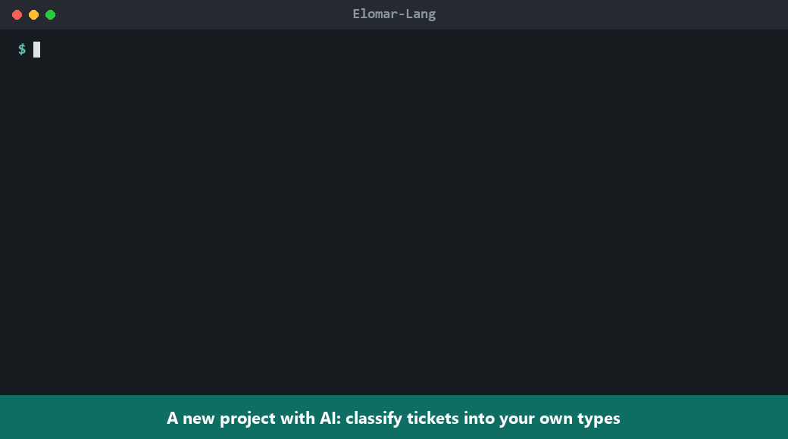
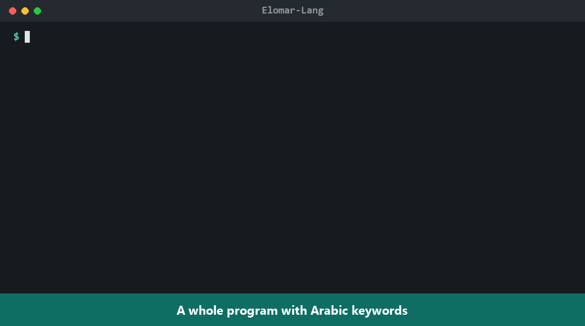

# دروس Elomar-Lang

اثنا عشر درسًا قصيرًا. في كل درس برامج يمكنك نسخها إلى ملف وتشغيلها بالأمر
`elomar run`. لا تحتاج أي خبرة سابقة في البرمجة للدروس الخمسة الأولى.
وفي آخر معظم الدروس تمارين تحلّها في الصفحة نفسها: اكتب حلك، واضغط **تحقّق**،
فترى هل يعمل.

<p></p>

لا وقت للتثبيت الآن؟ [صفحة التجربة](playground.html) تشغّل البرامج في متصفحك، وفي
[معرض البرامج](playground.html#ex-hello) أمثلة قصيرة تعمل بنقرة واحدة.

الدروس تكتب الكلمات المحجوزة بالإنجليزية (`fn`، `let`، `if`)، ولكل منها كتابة عربية
(`دالة`، `ليكن`، `إذا`) تستطيع أن تكتب بها البرنامج كله:

```elomar
دالة رئيسية() {
    لكل ع في 1..=3 {
        إذا ع == 2 { تابع }
        print("العدد", ع)
    }
}
```

كل الكلمات في [جدول الكلمات المحجوزة](12-reference.html#keywords). وزر **«دالة ليكن إذا»** فوق كل درس يعرض
أمثلته كلها بالكلمات العربية.

<p></p>


{{ forloop.index }}. [{{ l.ar }}]({{ l.slug }}.html)


كل الدوال في [المرجع](12-reference.html)، وصفحة [الجديد](news.html) تذكر ما أضافه كل إصدار. ولكل التفاصيل،
[مواصفة اللغة](https://github.com/abobasel86/elomar-lang/blob/main/docs/grammar.md) مكتوبة بالعربية وتشرح كل القواعد
والدوال ورموز الأخطاء.
