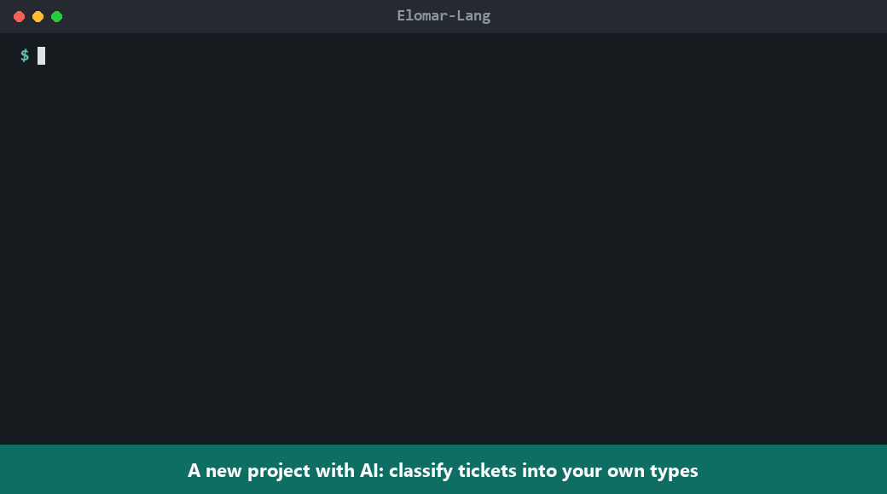

# The Elomar-Lang tutorial

Twelve short lessons. Each one has programs you can copy into a file and run
with `elomar run`. No programming experience is needed for the first five.
Most lessons end with exercises you solve right on the page: write your
answer, press **Check**, and see whether it works.

No time to install yet? The [playground](playground.html) runs programs in
your browser, and its [gallery](playground.html#ex-hello) has short ones
that run with one click.


{{ forloop.index }}. [{{ l.en }}]({{ l.slug }}.html)


Every function and method is in the [reference](12-reference.html), and
[what's new](news.html) tells what each version added. For every detail,
the [language specification](https://github.com/abobasel86/elomar-lang/blob/main/docs/grammar.en.md)
lists all syntax, functions and error codes.
