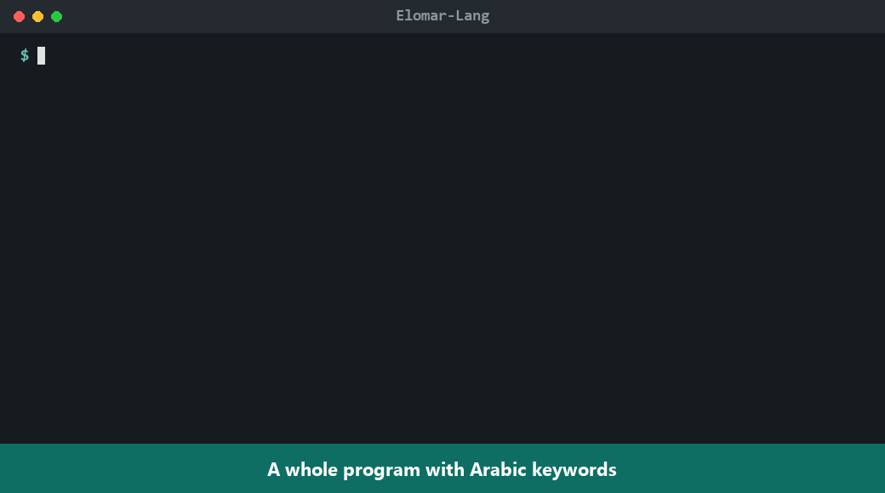

# What's new

## The Arabic switch converts everything

- **«دالة ليكن إذا»** on the lessons and **fn ⇄ دالة** in the playground now
  write the whole program in Arabic: `print` becomes `اطبع`, `List<Int>`
  becomes `قائمة<صحيح>`, `.length` becomes `.طول`. And back.
- `elomar fmt --keywords ar` (or `en`) does the same to your files.
- A name stays as written where your program has its own thing with that
  name, so the program always means the same.

## 1.15: Arabic names for methods

- **`.طول` is `.length`, `.حول` is `.map`**: every method of the built-in
  types has an Arabic name, so a program can now be written wholly in
  Arabic, as the [gallery](playground.html#example=keywords) one is.
- `.أضف` is `push` on a list and `add` on a set: the type of the value
  decides. A record field with the same name still wins.
- All of them are in the [reference](12-reference.html#arabic-methods).

## 1.14: Arabic names for built-ins

- **`اطبع` is `print`, `نص` is `String`**: the built-in functions, `قيمة` /
  `لاشيء` / `نجاح` / `فشل` (`Some` / `None` / `Ok` / `Err`) and the core
  types (`صحيح`, `نص`, `قائمة<…>`, `نتيجة<…>`, …) have Arabic names. With the
  Arabic keywords, a whole program can now be in Arabic; the
  [gallery](playground.html#example=keywords) has one.
- They are not reserved: a variable named `نص` in your program still works,
  and hides the type only where it is visible.
- All of them are in the [reference](12-reference.html#arabic-names).
- A string inside a list or `Err(...)` now prints its harakat as written.

## 1.13.1: Arabic keywords on every lesson page

- Above every lesson, **«fn let if» / «دالة ليكن إذا»** switches all the
  examples between English and Arabic keywords; the choice is remembered
  on your device. Code with Arabic keywords reads right to left.
- The [playground](playground.html) has a **fn ⇄ دالة** button that
  rewrites your program with Arabic keywords, or back.
- `elomar fmt --keywords` now also changes keywords inside a string's
  `{...}`.

## 1.13: Arabic keywords

- **Write the whole program in Arabic**: `دالة` is `fn`, `ليكن` is `let`,
  `إذا` is `if`, `لكل … في` is `for … in`, and so on for every keyword. A
  program may start in `رئيسية` instead of `main`. Mix the two languages
  freely. All of them are in the [table of keywords](12-reference.html#keywords),
  and the [gallery](playground.html#example=keywords) has a program to run.
- `elomar fmt --keywords ar` rewrites a file with Arabic keywords, and
  `--keywords en` with English ones.
- Hamza, harakat and tatweel do not matter: `ارجع` and `أرجع`, `نفّذ` and
  `نفذ` are the same keyword.
- Since Arabic keywords are reserved, a variable named `نوع` or `في` needs
  another name; the error message tells you which.

## Scoop and Homebrew, a gallery, and a demo

- **Install with Scoop or Homebrew**:
  `scoop bucket add elomar https://github.com/abobasel86/elomar-lang` then `scoop install elomar` on Windows;
  `brew tap abobasel86/elomar https://github.com/abobasel86/elomar-lang` then `brew install elomar` on macOS
  and Linux. Each release updates them, so `scoop update` and
  `brew upgrade` find the new version. See [Getting started](01-start.html).
- **A gallery of programs** under the [playground](playground.html#ex-hello):
  Arabic text, JSON read into your own types, dates, every processor core,
  and typed AI answers. A card opens its program and runs it; its link
  (`playground.html#example=json`, for instance) opens it for anyone.
- **A short demo** on the [home page](index.html): a new AI project, its
  types, its output, and an error message in Arabic.

## 1.12.1: ARM, and two fixes

- **Linux and Windows on ARM**: ready-made builds for Raspberry Pi, ARM
  servers and Windows on ARM laptops. The one-line installers pick them.
- A module may again be named like a standard module (`src/csv.elo` with
  `use app.csv`, or a package's `csvkit.csv`); only a file that imports both
  `std.csv` and `app.csv` is an error.
- The installers and `elomar upgrade` no longer fail with HTTP 403 on
  shared networks.

## 1.12: install in one line, upgrade in one word

- **Install with one line.** On Windows (PowerShell):
  `irm https://raw.githubusercontent.com/abobasel86/elomar-lang/main/install.ps1 | iex`. On Linux or macOS:
  `curl -fsSL https://raw.githubusercontent.com/abobasel86/elomar-lang/main/install.sh | sh`. The installer checks the download against the release's
  checksums and adds `elomar` to your `PATH`.
- **`elomar upgrade`** moves you to the newest version
  (`elomar upgrade --check` only tells you whether there is one).
- **`elomar doctor` checks the whole project**: besides the AI setup,
  packages, Python, the programs MCP servers need, and the folders a
  program may use.
- **Contributing**: a [guide](https://github.com/abobasel86/elomar-lang/blob/main/CONTRIBUTING.md),
  a [security policy](https://github.com/abobasel86/elomar-lang/blob/main/SECURITY.md)
  and issue forms, in English and Arabic.

## 1.11: from nothing to a working AI project

- **`elomar new helpdesk --ai ollama`** (or `mock`, `openai`,
  `anthropic`) creates a project that calls a model: `elomar.toml` set for
  that provider, a module that classifies requests with `ai.infer`, a
  search with `ai.search`, and tests that pass offline.
- **`elomar doctor`** says what is missing before you run: a key that is
  not set or that the provider rejects, a host that is not allowed, a
  server that is not running, or a model id the provider does not have
  (with similar ids, or the `ollama pull` to run). It asks only for the
  list of models, which costs nothing, and never prints a key.
- [The AI lesson](09-ai.html) has three exercises you solve in the
  browser.

## 1.10: a free model on your computer

- **Models on your computer, no key**: point an `openai` model at
  [Ollama](https://ollama.com) (`base_url = "http://localhost:11434/v1"`)
  and `ai.infer`, `ai.stream`, `ai.embed` and `ai.search` run on your own
  machine, with no key and no cost per call. The same program runs on
  OpenAI or Claude by changing `elomar.toml` alone.
- **Embedding cache**: `[ai.cache] embeddings = "embeddings.cache.json"`
  keeps vectors between runs, so searching the same notes again sends
  nothing. On a test machine the second run took 70 ms instead of 3.4 s.

[The AI lesson](09-ai.html) shows both, and
[`examples/ai-local`](https://github.com/abobasel86/elomar-lang/tree/main/examples/ai-local)
is ready to run.

## 1.9: every function is a value, and search by meaning

- **Built-in functions are values**: `xs.map(to_string)`,
  `xs.fold(0, max)`, `["1", "x"].map(parse_int)` and `let say = print`.
  With 1.8's functions with bounds, every function in the language can now
  be passed as a value, and the specification's "not implemented yet"
  list is empty.
- **`ai.search(model, query, texts)`** returns the texts closest in
  meaning to a question, with their scores, in one call. The texts are
  embedded together, so an OpenAI model needs one request for up to 256.
- The fuzzer now also builds programs around traits and function values
  and checks that both engines agree on them.

[Lesson 4](04-collections.html) passes built-in functions, and
[the AI lesson](09-ai.html) shows `ai.search`.

## 1.8: bounded functions as values, and embedding in batches

- **Functions with trait bounds are values**: `[1, 2].map(show)`,
  `let f = show` and `apply(show, 3)` work when `show` is
  `fn show<T: Describe>`.
- **`await all` embeds together**: the `ai.embed` calls in one `all` go to
  each model at once, and an OpenAI model embeds up to 256 texts in one
  request.
- **HTTPS behind antivirus programs and proxies**: `std.http` and the AI
  providers trust your system's certificates too, so calls work where a
  program such as Kaspersky inspects secure connections.
- **Clearer model errors**: if the vendor rejects a model id, the error
  says to check `model` in `elomar.toml`.
- Streaming and embeddings were checked against the real OpenAI and Claude
  services.

[The AI lesson](09-ai.html) shows batching and how each user sets their
own key.

## 1.7: streaming, meaning, and generic traits

- **`ai.stream`** shows an answer while the model writes it: your function
  gets each piece as it arrives, and the result is the whole text. OpenAI
  and Claude stream for real; the mock model streams word by word.
- **`ai.embed`** turns a text into numbers that stand for its meaning, and
  **`ai.similarity`** compares two, so a program can search notes by
  meaning. The mock model does it offline, from the words.
- **`impl<T: Describe>`**: a generic type can implement a trait when its
  contents do, as `Box<T>` describing itself with its item's description,
  nested as deep as you like.
- **Maps and sets** have `filter`, `any`, `all` and `count`, maps
  `map_values` and sets `map`.
- The specification is now also [in English](https://github.com/abobasel86/elomar-lang/blob/main/docs/grammar.en.md),
  and lesson 11 has exercises.

[The AI lesson](09-ai.html) shows streaming and embeddings.

## Every core, the same answers

*Elomar-Lang 1.1 to 1.6: how the language became many times faster without
changing what a single program prints.*

A year's worth of speed came in a few weeks of versions. The rule behind
all of it is simple: **a faster program must print exactly what the slower
one printed, and fail with exactly the same error at the same place.**
Nothing you write has to change to get the speed.

### 1.1: a bytecode engine

Each function is now compiled into instructions over numbered registers
the first time it is called. A variable is read by its number instead of
being searched for by name, and a loop is a jump. Programs run about twice
as fast as in 1.0, loops about five times.

### 1.2: `await all` on every core

`await all([...])` runs neighbouring `async` calls at the same time, each
on its own core, when they are **isolated**: they print nothing, read no
input, and touch no file, database, process or AI model. Eight heavy
computations take 139 ms instead of 1787 ms in 1.0.

### 1.3 to 1.6: the `par_` methods

A list method whose name starts with `par_` gives what the same method
without it gives, with the work split over the cores:

| Over 300,000 numbers | One core | Every core |
|---|---|---|
| `par_map` (Collatz steps) | 1199 ms | 193 ms |
| `par_filter` (primes) | 434 ms | 70 ms |
| `par_fold` (longest path) | 4669 ms | 533 ms |
| `par_count` (primes) | 298 ms | 55 ms |
| `par_sort_by` (Collatz keys) | 1040 ms | 152 ms |
| `par_sum_by` (Collatz steps) | 1248 ms | 140 ms |
| `par_max_by` (Collatz steps) | 1252 ms | 149 ms |

There are thirteen of them now: `par_map`, `par_filter`, `par_fold`,
`par_any`, `par_all`, `par_find`, `par_count`, `par_sort_by`,
`par_min_by`, `par_max_by`, `par_sum_by`, `par_flat_map` and
`par_group_by`. [Speed and parallelism](11-speed.html) shows them all.

### How the answers stay the same

- Only isolated functions run on the cores; anything else runs one item
  after another, so what it prints keeps its order.
- When several items fail, the error is the first one's, and the parts
  after it are stopped. `par_find` stops at the first part that finds its
  item, so an error or an endless loop after it never shows, just as
  `find` would never reach it.
- `par_fold` splits a list into parts that depend on its length alone, so
  it gives the same result on every computer.
- A fuzzer writes thousands of programs aimed at the `par_` methods, with
  conditions that fail at one item or never end after another, and runs
  each on every core and on one: in more than 9,000 such programs, the two
  never differed.

### Text and records, too

- 1.5: `s += t` appends in place, so building a large text in a loop takes
  9 ms instead of 571 ms; going through a long text by index with `slice`
  takes 5 ms instead of 37 seconds, Arabic text with marks included.
- 1.6: reading a field remembers where the field was, and records are
  built with one allocation: reading the sixth field of a record a million
  times takes 20 ms instead of 29 ms.

## Versions

| Version | What it brought |
|---|---|
| **1.15** | Arabic names for methods (`.طول`, `.أضف`, `.حول`, …) |
| 1.14 | Arabic names for built-in functions and types (`اطبع`, `نص`, `قائمة`, …) |
| 1.13 | Arabic keywords (`دالة`, `ليكن`, `إذا`, …); `elomar fmt --keywords`; Scoop and Homebrew; the playground gallery; the keyword switch on lessons (1.13.1) |
| 1.12 | One-line installers; `elomar upgrade`; `elomar doctor` for the whole project; ARM builds (1.12.1) |
| 1.11 | `elomar new --ai`; `elomar doctor`; exercises for the AI lesson |
| 1.10 | Local models (Ollama) without a key; an embedding cache |
| 1.9 | Built-in functions as values; `ai.search` |
| 1.8 | Functions with trait bounds as values; `ai.embed` in batches; HTTPS behind antivirus programs and proxies |
| 1.7 | `ai.stream`, `ai.embed`, `ai.similarity`; `impl<T: A>`; map and set methods; the specification in English |
| 1.6 | `par_flat_map`, `par_group_by`, `par_sum_by`, `par_min_by`, `par_max_by`; faster fields and records; the [reference](12-reference.html) and [speed](11-speed.html) pages |
| 1.5 | `par_any`, `par_all`, `par_find`, `par_count`, `par_sort_by`; appending in place; fast indexing into text |
| 1.4 | `par_filter` and `par_fold` |
| 1.3 | `par_map` |
| 1.2 | `await all` on every core |
| 1.1.1 | Fixes in `elomar fmt` and `group_by` |
| 1.1 | The bytecode engine |
| 1.0 | The first stable version: programs that work with 1.0 keep working with every 1.x |

Every change, in detail, is in the
[changelog](https://github.com/abobasel86/elomar-lang/blob/main/CHANGELOG.md).
