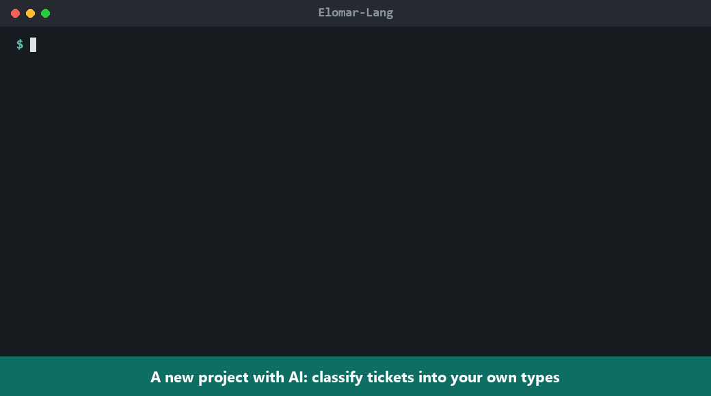

# Elomar-Lang

A simple, typed programming language with AI built in, designed to be easy
to learn in **Arabic** and **English**.

```elomar
use std.ai

type Ticket = { category: String, urgent: Bool }

fn main() {
    let name = "Lina"
    print("Hello, {name}!")
    print([3, 1, 2].sorted().map(|x| x * 10))
}
```

<div class="cards">
  <div class="card" lang="ar" dir="rtl">
    <h3>ابدأ بالعربية</h3>
    <p>دروس قصيرة تبدأ من الصفر حتى بناء خادم ويب وبرامج تستخدم الذكاء الاصطناعي.</p>
    <p><a href="ar/">الدروس بالعربية ←</a></p>
  </div>
  <div class="card">
    <h3>Start in English</h3>
    <p>Short lessons from your first program to web servers and AI-powered programs.</p>
    <p><a href="en/">The English tutorial →</a></p>
  </div>
</div>

## Why Elomar-Lang

- **Easy to read.** Plain syntax, clear error messages in English or Arabic,
  and Arabic names for your own variables and functions if you like.
- **Keywords in Arabic, too.** `دالة` is `fn`, `ليكن` is `let`, `إذا` is
  `if`: write a whole program in Arabic, in English, or mix them
  ([all keywords](en/12-reference.html#keywords), [بالعربية](ar/12-reference.html#keywords)).
- **Safe by default.** Static types, no `null`, errors as values, and
  programs may only touch the files, hosts, ports and programs you allow.
- **AI as part of the language.** `ai.infer<T>` returns a checked value of
  your type; agents use your functions and MCP tools, with approvals in code.
- **Batteries included.** Files, JSON, HTTP client and server, SQLite,
  regex, time, crypto, Python, packages, a formatter, tests and a VS Code
  extension.

## See it work

<p></p>

Or run short programs in your browser, with nothing to install: the
[playground's gallery](en/playground.html#ex-hello)
([بالعربية](ar/playground.html#ex-hello)).

## Install

On Windows (PowerShell):

```powershell
irm https://raw.githubusercontent.com/abobasel86/elomar-lang/main/install.ps1 | iex
```

On Linux or macOS:

```bash
curl -fsSL https://raw.githubusercontent.com/abobasel86/elomar-lang/main/install.sh | sh
```

Or with Scoop (`scoop bucket add elomar https://github.com/abobasel86/elomar-lang`, then `scoop install elomar`)
or Homebrew (`brew tap abobasel86/elomar https://github.com/abobasel86/elomar-lang`, then `brew install elomar`).
Every way is in [Getting started](en/01-start.html)
([البداية](ar/01-start.html)).

## Sponsors

Elomar-Lang is free and open source. Sponsors make its development possible.

<div class="sponsors">

  <a class="sponsor" href="{{ s.url }}">{{ s.name }}</a>

</div>

<p><a class="sponsor-button" href="https://github.com/sponsors/abobasel86">♥ Sponsor Elomar-Lang</a>
 · <a href="https://github.com/sponsors/abobasel86" lang="ar" dir="rtl">ادعم المشروع</a></p>
